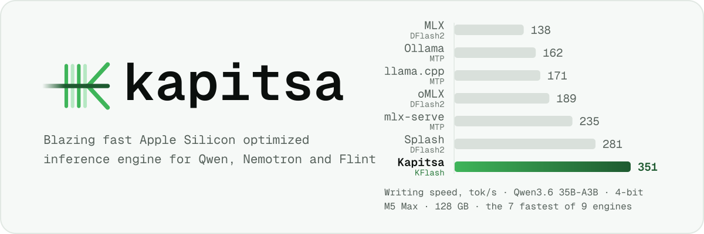
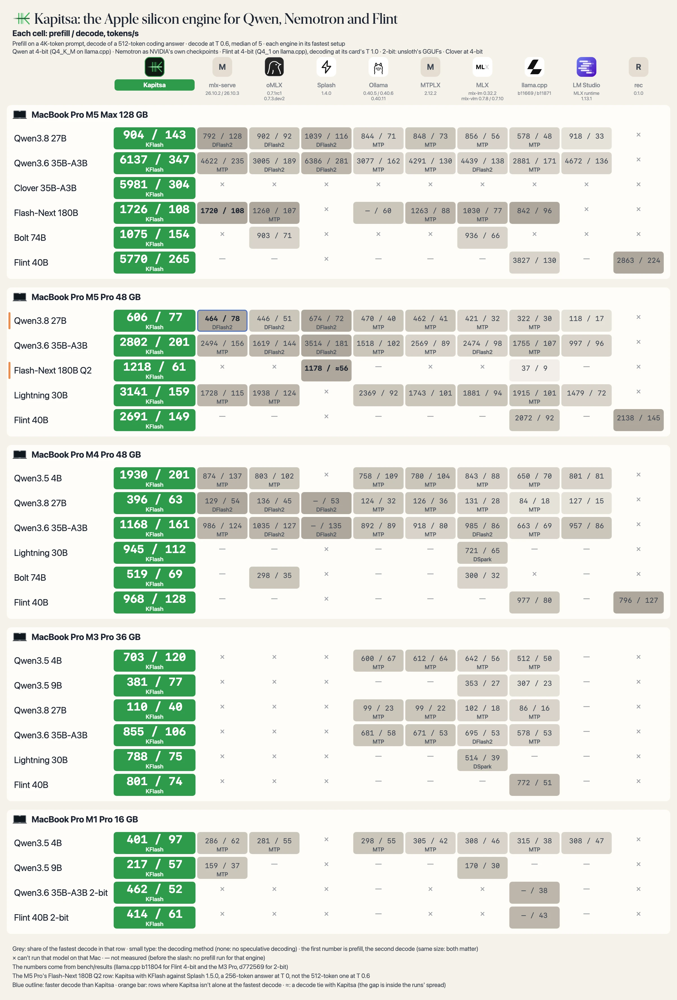

<picture>
  <source media="(max-width: 600px)" srcset="docs/assets/header-narrow.svg">
  <source media="(prefers-color-scheme: dark)" srcset="docs/assets/header-dark.svg">
  
</picture>

[English](README.md) · **日本語**

Kapitsa は、Qwen、Nemotron、Recursive の Flint モデルをローカルで動かす Apple silicon 向けの推論エンジンで、コーディングエージェントのために作られています。opencode、Claude Code、Codex、pi をローカルモデルで起動でき、OpenAI 互換と Anthropic 互換の API を提供します。

<sub>この日本語版は英語版 [README.md](README.md) の一部を翻訳したものです。ベンチマークの数値、モデル一覧、更新情報は英語版を参照してください。内容に相違がある場合は、英語版を優先してください。</sub>

[クイックスタート](#クイックスタート) · [ベンチマーク](#ベンチマーク) · [機能](#機能) · [CLI](#cli) · [対応モデル](README.md#models) · [KFlash の仕組み](docs/kflash.md) · [ドキュメント（英語）](docs/usage.md)

## クイックスタート

**動作環境:** Apple silicon（M1 以降）を搭載した Mac と、macOS 14 Sonoma 以降。

**制限:** Apple silicon 専用で、Linux と Windows には対応していません。Flint、テキスト専用の 4 種類の Nemotron モデル、35B の `16gb` ビルドはテキストのみを読み、画像は読みません（[画像を読めるモデル](docs/usage.md#images)）。

```bash
brew install nace-ai/tap/kapitsa
# または: curl -fsSL https://raw.githubusercontent.com/nace-ai/kapitsa/main/install.sh | bash
```

```bash
kapitsa opencode --model 35b    # claude、codex、pi も使えます
```

<sub>メモリが 16〜24 GB の Mac では `--model 9b` を、いちばん速く返答させたいときは `4b` を使ってください。</sub>

## ベンチマーク

各エンジンと比較した測定結果は、次のポスターと英語版の表にまとまっています（[各数値の測定方法](docs/benchmarks.md#how-the-readme-poster-was-measured)）。

<picture>
  <source media="(prefers-color-scheme: dark)" srcset="docs/assets/benchmarks-dark.webp">
  
</picture>

<sub>各セルはプリフィル / デコードの速度（トークン毎秒）を示します。測定には、4K トークンのプロンプトと、T 0.6 で生成する 512 トークンの回答を使っています（Flint はモデルカードの T 1.0）。一部の行は条件が異なり、その条件は英語版の注記にあります。脚注、測定日、フラグは [docs/benchmarks.md](docs/benchmarks.md#how-the-readme-poster-was-measured) にあります。</sub>

Mac ごと、モデルごとの表は英語版の [Speed on each Mac](README.md#speed-on-each-mac) に、記録したすべての測定は[ベンチマーク表](bench/README.md)にあります。自分の Mac で `kapitsa bench --submit` を実行すると、測定結果が[コミュニティのベンチマーク結果](bench/community/RESULTS.md)に追加されます。手元の Mac で別のエンジンのほうが速い場合は、`kapitsa bench compare` がインストール済みのすべてのエンジンを順位付けし、`--report` で Markdown のレポートを書き出します。

## 機能

- **KFlash による木構造の投機的デコード。** 1 回の検証パスで、ドラフトモデルの推測を木構造のまま確かめます。ドラフトモデルが公開されているモデルには、DFlash2、DFlash、MTP、DSpark、LiLiCorr のいずれかが付いています（[仕組み](docs/kflash.md)）。
- **48 GB の Mac で 180B モデル。** ルーティングされたエキスパートのうち、メモリに収まらない分は SSD から読み込まれます。
- **再起動後も会話の続きがすぐ始まります。** 会話の状態は SSD に保存されます（`--disk-cache`）。
- **GPU と Neural Engine で一緒にプリフィル。** プリフィルの一部を Neural Engine に任せ、GPU の待ち時間を減らします。
- **今のツールがそのまま使えます。** `/v1/chat/completions`、`/v1/messages`、`/v1/responses`（ストリーミング、ツール呼び出し、JSON スキーマ出力に対応）とチャットページを、すべて `http://127.0.0.1:8000` で提供します。
- **コマンド 1 つでエージェント。** `kapitsa claude`、`kapitsa codex`、`kapitsa opencode`、`kapitsa pi` がローカルモデルで起動します。
- **選択肢ごとに較正された確率を 1 つ。** `kapitsa-systemone` は [Drex decision models](https://github.com/nace-ai/drex-decision-models) をこの形で提供します。状態と質問を渡すと、選択肢ごとの確率が返ります（`POST /v1/systemone`）（[API](docs/systemone.md)、[セットアップ](docs/drex-max.md)）。v1 には Kapitsa v0.2.25 以降が必要です。モデルのインポートとポインターヘッドの抽出手順は[ガイド](docs/drex-max.md)を参照してください。
- **複数の Mac で 1 つのモデル。** モデルを載せきれない Mac は、載せられる Mac にリクエストを送ります。`--split` を使うと、1 つのモデルの層をネットワーク上の複数の Mac に分けて載せます（[複数の Mac](docs/usage.md#several-macs)）。
- **画像。** チャットページと API でスクリーンショットや写真を扱えます。テキスト専用の 4 種類の Nemotron モデル、Flint、Clover、35B の `16gb` を除く、カタログのすべてのモデルが対象です。

## CLI

```bash
kapitsa serve                   # チャット + OpenAI/Anthropic API（http://127.0.0.1:8000）
kapitsa claude                  # Kapitsa 上の Claude Code
kapitsa doctor                  # この Mac の GPU とメモリ、載せられるモデル
kapitsa cluster                 # このネットワークで Kapitsa を動かしている Mac とそのモデル
kapitsa bench                   # この Mac をベンチマークし、コミュニティと共有
kapitsa bench compare           # 同じテストを、ここにインストールされた他のエンジンでも実行
kapitsa pull 27b                # モデルを起動せずにダウンロード
kapitsa list                    # ダウンロード済みのモデルとそのサイズ
kapitsa rm 27b                  # ダウンロードしたモデルを削除
kapitsa import model.gguf       # LM Studio、Ollama、llama.cpp の Qwen または Flint の GGUF を使う
kapitsa update                  # 今すぐ更新（自動でも更新されます）
```

<sub>`--model` でモデルと精度を選びます（`35b:6bit`）。オプションは `kapitsa <command> --help` で確認できます。モデル全体を載せきれない Mac は、ネットワーク上でそのモデルを動かしている別の Mac を使います。単体では Flash-Next を SSD からストリーミングする必要がある Mac でも、2 台を組み合わせれば両方のメモリに分けて保持できます（[複数の Mac](docs/usage.md#several-macs)）。`--private` を付けると、サーバーは自分の Mac の中だけで使われます。[使い方ガイド（英語）](docs/usage.md)</sub>

## アプリへの組み込み

アプリへの組み込みには、[C ABI SDK](sdk/README.md) と [Node.js / TypeScript バインディング](sdk/node/README.md)を利用できます。読み込んだモデルを再利用し、リクエストのストリーミングとキャンセルができます。ビルド手順とホストプロセスの寿命に関する制約は、英語版の [In-process SDK](README.md#in-process-sdk) を参照してください。

## 対応モデル

Qwen3.5（4B、9B）、Qwen3.6-35B-A3B、Qwen3.8（27B、Flash-Next 180B-A7B）、Nemotron 3.5（Lightning、Bolt、Super-VL）、Nemotron Dory1.0 4B、Nemotron 3 Nano 4B、Nemotron Nano 9B v2、Recursive Flint 40B-A2.5B、Clover-35B-A3B-Preview、Drex 2.0 に対応しています。Mac のメモリ容量ごとにどの精度が動くかは英語版の[対応モデルの表](README.md#models)にあり、`kapitsa doctor` は同じ内容をこの Mac について表示します。

## 仕組み

Kapitsa は **KFlash** でデコードします。DFlash2 のようなドラフトモデルが、次の 7 トークンを、それぞれいくつかの候補とともに推測します。ドラフトモデルを公開元の方式どおりに使うエンジン（Splash、oMLX、mlx-serve）は、予測候補を 1 本の列として検証し、最初に外れたところで止まります。KFlash は同じパスの中で、ドラフトモデルの候補から最良優先で構築した木構造を検証します。そのため、ドラフトモデルが迷ったところでは次点の候補も確かめられ、1 回のパスで残るトークンが増えます。木の大きさは、その Mac で測った検証 1 行あたりのコストで決まります。出力は変わりません。すべてのトークンを大きなモデルが確かめるからです。公開されているドラフトモデルをそのまま使います: z-lab の DFlash、DFlash2、NVIDIA の DSpark と LiLiCorr です。[KFlash の仕組み（英語）](docs/kflash.md)

## リリース通知を受け取る

[nace-ai/kapitsa](https://github.com/nace-ai/kapitsa) で Watch → Custom → Releases を選ぶと、新しいバージョンが出るたびに通知が届きます。

<sub>[KFlash の仕組み](docs/kflash.md) · [アーキテクチャ](docs/architecture.md) · [コントリビュート](CONTRIBUTING.md) · [プレスキット](docs/assets/brand/README.md) ·
Apache 2.0, © 2026 [Nace AI](https://nace.ai) · [サードパーティの表記](THIRD_PARTY_NOTICES)（いずれも英語）</sub>
