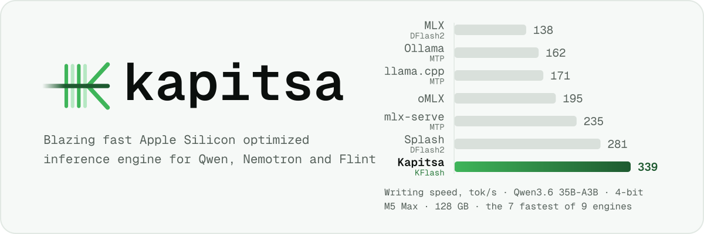
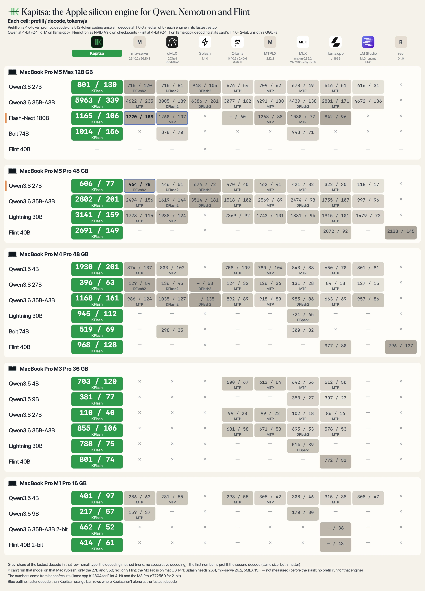
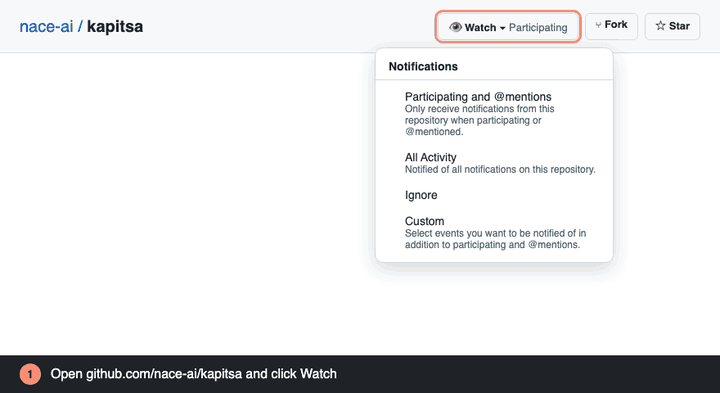

<picture>
  <source media="(max-width: 600px)" srcset="docs/assets/header-narrow.svg">
  <source media="(prefers-color-scheme: dark)" srcset="docs/assets/header-dark.svg">
  
</picture>

Kapitsa is an inference engine for Apple silicon that runs Qwen, Nemotron and Recursive's Flint models locally, built for coding agents. It starts opencode, Claude Code, Codex or pi on a local model, and serves OpenAI and Anthropic APIs.

[Quickstart](#quickstart) · [CLI](#cli) · [Benchmarks](#benchmarks) · [Models](#models) · [How KFlash works](docs/kflash.md) · [Docs](docs/usage.md)

## 🔥 What's new

- [2026/10] 🪨 **Recursive's Flint 40B-A2.5B: on the M4 Pro, 1.1-1.2× the prompt speed of Recursive's own engine.** Decode is level with it on short prompts and pulls ahead as the context grows, to 1.3× at 128K tokens, and 1.6-1.9× llama.cpp's ([numbers](docs/benchmarks.md#recursive-flint-40b-a25b-m4-pro-2026-10-22)). On the M5 Pro rec reads prompts 1.4-2.3× as fast as Kapitsa and llama.cpp 1.6-1.7×; decode is level with rec to about 1.1× ahead from 16K, and 1.5-1.6× llama.cpp's ([numbers](docs/benchmarks.md#recursive-flint-40b-a25b-m5-pro-2026-10-22)).
- [2026/10] 🚀 **KFlash: tree speculative decoding, up to 3.5× llama.cpp and 2.2× oMLX.** One verify pass checks a whole tree of the drafter's guesses ([how it works](docs/kflash.md)).
- [2026/10] 🏆 **Kapitsa: the fastest decode in 24 of 26 model and Mac pairs** against nine engines, up to 2.6× MLX ([poster](#benchmarks)).
- [2026/10] 🤝 **KFlash budget: subagents decode together.** Three requests at once share one verify pass, up to **+23% total throughput** on the 27B.
- [2026/10] ⚡ **QMT prefill: read the prompt up to 1.5× faster on M5.** Metal 4 matrix units for the prompt (4B, M5 Pro).
- [2026/10] 💾 **SSD prefix cache: restart the server, keep the conversation.** A 16K-token follow-up on the 35B starts in **0.16 s instead of 17 s**, about 100× (`--disk-cache`).
- [2026/10] 🧠 **Prefix reuse: subagents start warm.** A new question over the shared system prompt answers in **0.06 s instead of 1.9 s** (4K prompt, 4B, M5 Pro).
- [2026/10] 🧪 **Output check: speed has to prove it kept the answers.** A default changes only after its logits stay within twice the model's noise floor ([how](CONTRIBUTING.md#output-check)).
- [2026/10] 📊 **`kapitsa bench compare`: see it on your own Mac.** The same test against every engine installed here, in one command.

## Quickstart

**Requirements:** a Mac with Apple silicon (M1 or newer) and macOS 14 Sonoma or later.

```bash
brew install nace-ai/tap/kapitsa
# or: curl -fsSL https://raw.githubusercontent.com/nace-ai/kapitsa/main/install.sh | bash
```

```bash
kapitsa opencode --model 35b    # also: claude, codex, pi
```

<sub>On a 16-24 GB Mac use `--model 9b`, or `4b` for the quickest replies.</sub>

## CLI

```bash
kapitsa serve                   # chat + OpenAI/Anthropic APIs at http://127.0.0.1:8000
kapitsa claude                  # Claude Code on Kapitsa
kapitsa doctor                  # this Mac's GPU and memory, and which models fit it
kapitsa bench                   # benchmark this Mac, share it with the community
kapitsa bench compare           # the same test against the other engines installed here
kapitsa pull 27b                # download a model without starting it
kapitsa list                    # downloaded models and their size
kapitsa rm 27b                  # delete a downloaded model
kapitsa import model.gguf       # use a Qwen GGUF from LM Studio, Ollama or llama.cpp
kapitsa update                  # update now (it also updates itself)
```

<sub>`--model` picks the model and its precision (`35b:6bit`). `kapitsa <command> --help` has the options.
[Usage guide](docs/usage.md)</sub>

## Benchmarks

Kapitsa has the fastest decode in 24 of the 26 model and Mac pairs measured against nine engines ([how each number was measured](docs/benchmarks.md#how-the-readme-poster-was-measured)).

<picture>
  <source media="(prefers-color-scheme: dark)" srcset="docs/assets/benchmarks-dark.webp">
  
</picture>

<sub>**Each cell reads prefill / decode in tokens per second.** Prefill is a 4K-token prompt, decode a 512-token answer at T 0.6 (Flint at its card's T 1.0). × cannot run that model · — not measured. How these were measured, run dates and flags: [docs/benchmarks.md](docs/benchmarks.md#how-the-readme-poster-was-measured).</sub>

The poster's numbers, and the models it leaves out, are in each Mac's table under [Models](#models). Every recorded run, with its Mac, model, prefill and decode speed, is in the [benchmark table](bench/README.md). Measure your Mac: `kapitsa bench --submit` adds it to the [community results](bench/community/RESULTS.md). Another engine faster on your Mac? `kapitsa bench compare` ranks every engine you have installed, and `--report` writes a Markdown report.

## Models

The catalog models measured on each Mac, against the engines that run them: one table per Mac. Decode is a 512-token coding answer at T 0.6 (Flint at its card's T 1.0), prefill a 4K-token prompt. Under each model's name are the weights Kapitsa ran; the other engines' weights and how each number was measured are in [docs/benchmarks.md](docs/benchmarks.md#the-readmes-tables).

<sub>Each cell: prefill / decode, tokens/s (a lone number is decode: no prefill run) · 🟩 fastest decode · ≈ a decode tie with Kapitsa · small type: the decoding method · × can't run on that Mac · — not measured</sub>

<details>
<summary><b>MacBook Pro (16-inch, 2026) · M5 Max · 128 GB</b> · 7 models</summary>

| Model | <mark>**Kapitsa**</mark> | <sub>mlx‑serve<br>26.10.2</sub> | <sub>oMLX<br>0.7.1rc1</sub> | <sub>Splash<br>1.4.0</sub> | <sub>Ollama<br>0.40.5 / 0.40.6</sub> | <sub>MTPLX<br>2.12.2</sub> | <sub>MLX<br>mlx-lm 0.32.2, mlx-vlm 0.7.8</sub> | <sub>llama.cpp<br>b11669</sub> | <sub>LM&nbsp;Studio<br>MLX runtime 1.13.1, llama.cpp runtime 2.60.0</sub> |
| --- | ---: | ---: | ---: | ---: | ---: | ---: | ---: | ---: | ---: |
| **Qwen3.8-27B** · `27b`<br><sub>dense · 4-bit, 20.2 GB</sub> | 🟩 459 / **140**<br><sub>KFlash</sub> | 690 / 130<br><sub>DFlash2</sub> | 761 / 93<br><sub>DFlash2</sub> | 898 / 116<br><sub>DFlash2</sub> | 739 / 68 | 733 / 69<br><sub>MTP</sub> | 784 / 54<br><sub>MTP</sub> | 516 / 51<br><sub>MTP</sub> | 217 / 32<br><sub>no spec</sub> |
| **Qwen3.6-35B-A3B** · `35b`<br><sub>MoE, 3B active · 4-bit, 22.1 GB</sub> | 🟩 4702 / **325**<br><sub>KFlash</sub> | 3818 / 264<br><sub>MTP</sub> | 2968 / 232<br><sub>DFlash2</sub> | 6640 / 290<br><sub>DFlash2</sub> | 3690 / 166 | 4328 / 123<br><sub>MTP</sub> | 4271 / 132<br><sub>DFlash2</sub> | 2881 / 171<br><sub>MTP</sub> | 1873 / 127<br><sub>no spec</sub> |
| **Qwen3.8-Flash-Next 180B-A7B** · `flash-next`<br><sub>MoE, 7B active · 4-bit, 105.9 GB</sub> | 1165 / 106<br><sub>MTP</sub> | 🟩 1720 / **108** | 1260 / 107<br><sub>MTP</sub> | × | 60 | 1263 / 88<br><sub>MTP</sub> | 1030 / 77<br><sub>MTP</sub> | 842 / 96 | × |
| **Nemotron Dory1.0 4B** · `dory`<br><sub>looped dense · NVFP4, 3.2 GB</sub> | 🟩 **119**<br><sub>loops</sub> | × | × | × | × | × | 76 | 9 | × |
| **Nemotron 3.5 Lightning 30B-A3B** · `lightning`<br><sub>hybrid MoE, 3B active · NVFP4, 22.9 GB</sub> | 🟩 **267**<br><sub>KFlash</sub> | 190 | 190 | × | 153 | 131 | 139 | 159 | 110 |
| **Nemotron 3.5 Bolt 74B-A9B** · `bolt`<br><sub>hybrid MoE, 9B active · 2/4/8-bit mix, 25.1 GB</sub> | 🟩 1016 / **153**<br><sub>KFlash</sub> | × | 913 / 69<br><sub>no spec</sub> | × | × | × | 941 / 69 | × | × |
| **Nemotron 3.5 Super-VL 120B-A12B** · `super`<br><sub>hybrid MoE, 12B active · NVFP4, 76.4 GB</sub> | 🟩 **94**<br><sub>KFlash</sub> | × | 52 | × | 64 | 44 | 46 | 66 | 61 |

</details>

<details>
<summary><b>MacBook Pro (16-inch, 2026) · M5 Pro · 48 GB</b> · 6 models</summary>

| Model | <mark>**Kapitsa**</mark> | <sub>mlx‑serve<br>26.10.2</sub> | <sub>oMLX<br>0.7.1rc1</sub> | <sub>Splash<br>1.4.0</sub> | <sub>Ollama<br>0.40.5 / 0.40.6</sub> | <sub>MTPLX<br>2.12.2</sub> | <sub>MLX<br>mlx-lm 0.32.2, mlx-vlm 0.7.8</sub> | <sub>llama.cpp<br>b11669</sub> | <sub>LM&nbsp;Studio<br>MLX runtime 1.13.1, llama.cpp runtime 2.60.0</sub> | <sub>rec<br>0.1.0</sub> |
| --- | ---: | ---: | ---: | ---: | ---: | ---: | ---: | ---: | ---: | ---: |
| **Qwen3.8-27B** · `27b`<br><sub>dense · 4-bit, 20.2 GB</sub> | 🟩 618 / **79**<br><sub>KFlash</sub> | 464 / **≈78**<br><sub>DFlash2</sub> | 446 / 51<br><sub>DFlash2</sub> | 674 / 72<br><sub>DFlash2</sub> | 470 / 40<br><sub>MTP</sub> | 462 / 41<br><sub>MTP</sub> | 421 / 32<br><sub>MTP</sub> | 322 / 30<br><sub>MTP</sub> | 118 / 17<br><sub>no spec</sub> | × |
| **Qwen3.6-35B-A3B** · `35b`<br><sub>MoE, 3B active · 4-bit, 22.1 GB</sub> | 🟩 2552 / **209**<br><sub>KFlash</sub> | 2494 / 156<br><sub>MTP</sub> | 1619 / 144<br><sub>DFlash2</sub> | 3514 / 181<br><sub>DFlash2</sub> | 1518 / 102<br><sub>MTP</sub> | 2569 / 89<br><sub>MTP</sub> | 2474 / 98<br><sub>DFlash2</sub> | 1755 / 107<br><sub>MTP</sub> | 997 / 96<br><sub>no spec</sub> | × |
| **Nemotron Dory1.0 4B** · `dory`<br><sub>looped dense · NVFP4, 3.2 GB</sub> | 🟩 **70**<br><sub>loops</sub> | × | × | × | × | × | 53 | 13 | × | × |
| **Nemotron 3.5 Lightning 30B-A3B** · `lightning`<br><sub>hybrid MoE, 3B active · NVFP4, 22.9 GB</sub> | 🟩 3141 / **159**<br><sub>KFlash</sub> | 1728 / 115<br><sub>MTP</sub> | 1938 / 124<br><sub>MTP</sub> | × | 2369 / 92 | 1743 / 101 | 1881 / 94 | 1915 / 101<br><sub>MTP</sub> | 1479 / 72 | × |
| **Nemotron 3.5 Bolt 74B-A9B** · `bolt`<br><sub>hybrid MoE, 9B active · 2/4/8-bit mix, 25.1 GB</sub> | 🟩 **79**<br><sub>LiLiCorr</sub> | × | 39<br><sub>no spec</sub> | × | × | × | 41 | × | × | × |
| **Recursive Flint 40B-A2.5B** · `flint`<br><sub>MoE, 2.5B active · 4-bit, 22.6 GB</sub> | 🟩 1374 / **146**<br><sub>no spec</sub> | — | — | × | — | — | — | 2072 / 92<br><sub>no spec · b11804</sub> | — | 2138 / 145<br><sub>no spec</sub> |

</details>

<details>
<summary><b>MacBook Pro (16-inch, 2024) · M4 Pro · 48 GB</b> · 7 models</summary>

| Model | <mark>**Kapitsa**</mark> | <sub>mlx‑serve<br>26.10.2</sub> | <sub>oMLX<br>0.7.1rc1</sub> | <sub>Splash<br>1.4.0</sub> | <sub>Ollama<br>0.40.5 / 0.40.6</sub> | <sub>MTPLX<br>2.12.2</sub> | <sub>MLX<br>mlx-lm 0.32.2, mlx-vlm 0.7.8</sub> | <sub>llama.cpp<br>b11669</sub> | <sub>LM&nbsp;Studio<br>MLX runtime 1.13.1, llama.cpp runtime 2.60.0</sub> | <sub>rec<br>0.1.0</sub> |
| --- | ---: | ---: | ---: | ---: | ---: | ---: | ---: | ---: | ---: | ---: |
| **Qwen3.5-4B** · `4b`<br><sub>dense · 4-bit, 4.6 GB</sub> | 🟩 1930 / **201**<br><sub>KFlash</sub> | 874 / 137<br><sub>MTP</sub> | 803 / 102<br><sub>MTP</sub> | × | 758 / 109<br><sub>MTP</sub> | 780 / 104<br><sub>MTP</sub> | 843 / 88<br><sub>MTP</sub> | 650 / 70<br><sub>MTP</sub> | 801 / 81<br><sub>no spec</sub> | × |
| **Qwen3.8-27B** · `27b`<br><sub>dense · 4-bit, 20.2 GB</sub> | 🟩 396 / **63**<br><sub>KFlash</sub> | 129 / 54<br><sub>DFlash2</sub> | 136 / 45<br><sub>DFlash2</sub> | 53<br><sub>DFlash2</sub> | 124 / 32<br><sub>MTP</sub> | 126 / 36<br><sub>MTP</sub> | 131 / 28<br><sub>MTP</sub> | 84 / 18<br><sub>MTP</sub> | 127 / 15<br><sub>no spec</sub> | × |
| **Qwen3.6-35B-A3B** · `35b`<br><sub>MoE, 3B active · 4-bit, 22.1 GB</sub> | 🟩 1168 / **161**<br><sub>KFlash</sub> | 986 / 124<br><sub>MTP</sub> | 1035 / 127<br><sub>DFlash2</sub> | 135<br><sub>DFlash2</sub> | 892 / 89<br><sub>MTP</sub> | 918 / 80<br><sub>MTP</sub> | 985 / 86<br><sub>DFlash2</sub> | 663 / 69<br><sub>MTP</sub> | 957 / 86<br><sub>no spec</sub> | × |
| **Nemotron Dory1.0 4B** · `dory`<br><sub>looped dense · NVFP4, 3.2 GB</sub> | 🟩 **64**<br><sub>loops</sub> | × | × | × | × | × | 48<br><sub>no spec</sub> | 6<br><sub>no spec</sub> | × | × |
| **Nemotron 3.5 Lightning 30B-A3B** · `lightning`<br><sub>hybrid MoE, 3B active · NVFP4, 22.9 GB</sub> | 🟩 945 / **112**<br><sub>KFlash</sub> | — | — | × | — | — | 721 / 65<br><sub>DSpark</sub> | — | — | × |
| **Nemotron 3.5 Bolt 74B-A9B** · `bolt`<br><sub>hybrid MoE, 9B active · 2/4/8-bit mix, 25.1 GB</sub> | 🟩 519 / **69**<br><sub>KFlash</sub> | — | 298 / 35<br><sub>no spec</sub> | × | — | — | 300 / 32<br><sub>no spec</sub> | × | — | × |
| **Recursive Flint 40B-A2.5B** · `flint`<br><sub>MoE, 2.5B active · 4-bit, 22.6 GB</sub> | 🟩 968 / **128**<br><sub>no spec</sub> | — | — | × | — | — | — | 977 / 80<br><sub>no spec · b11804</sub> | — | 796 / 127<br><sub>no spec</sub> |

</details>

<details>
<summary><b>MacBook Pro (16-inch, 2023) · M3 Pro · 36 GB</b> · 1 model</summary>

| Model | <mark>**Kapitsa**</mark> | <sub>llama.cpp<br>b11804</sub> |
| --- | ---: | ---: |
| **Recursive Flint 40B-A2.5B** · `flint`<br><sub>MoE, 2.5B active · 4-bit, 22.6 GB</sub> | 🟩 801 / **74**<br><sub>no spec</sub> | 772 / 51<br><sub>no spec</sub> |

<sub>macOS 14.1, on AC power: Kapitsa's macOS 14 kernels (macOS 15 and later run fused ones). rec 0.1.0 refuses this Mac: it requires 48 GiB.</sub>

</details>

<details>
<summary><b>MacBook Pro (14-inch, 2021) · M1 Pro · 16 GB</b> · 6 models</summary>

| Model | <mark>**Kapitsa**</mark> | <sub>mlx‑serve<br>26.10.2</sub> | <sub>oMLX<br>0.7.1rc1</sub> | <sub>Ollama<br>0.40.5 / 0.40.6</sub> | <sub>MTPLX<br>2.12.2</sub> | <sub>MLX<br>mlx-lm 0.32.2, mlx-vlm 0.7.8</sub> | <sub>llama.cpp<br>b11669</sub> | <sub>LM&nbsp;Studio<br>MLX runtime 1.13.1, llama.cpp runtime 2.60.0</sub> |
| --- | ---: | ---: | ---: | ---: | ---: | ---: | ---: | ---: |
| **Qwen3.5-4B** · `4b`<br><sub>dense · 4-bit, 4.6 GB</sub> | 🟩 401 / **97**<br><sub>KFlash</sub> | 286 / 62<br><sub>MTP</sub> | 281 / 55<br><sub>MTP</sub> | 298 / 55<br><sub>MTP</sub> | 305 / 42<br><sub>MTP</sub> | 308 / 46<br><sub>no spec</sub> | 315 / 38<br><sub>MTP</sub> | 308 / 47<br><sub>no spec</sub> |
| **Qwen3.5-9B** · `9b`<br><sub>dense · 4-bit, 9.0 GB</sub> | 🟩 217 / **57**<br><sub>KFlash</sub> | 159 / 37<br><sub>MTP</sub> | — | — | — | 170 / 30<br><sub>no spec</sub> | — | — |
| **Qwen3.6-35B-A3B** · `35b:16gb`<br><sub>MoE, 3B active · 2-bit experts (unsloth's GGUF), 10.8 GB</sub> | 🟩 462 / **52**<br><sub>no spec</sub> | × | × | — | × | × | 38 | — |
| **Nemotron Dory1.0 4B** · `dory`<br><sub>looped dense · NVFP4, 3.2 GB</sub> | 🟩 **39**<br><sub>no spec</sub> | × | × | × | × | 30<br><sub>no spec</sub> | 4<br><sub>no spec</sub> | × |
| **Nemotron 3 Nano 4B** · `nano-4b`<br><sub>hybrid Mamba-2 · FP8, 5.3 GB</sub> | 🟩 **37**<br><sub>prompt lookup</sub> | — | — | — | — | 21<br><sub>BF16</sub> | 28<br><sub>Q4_K_M</sub> | — |
| **Nemotron Nano 9B v2** · `nano-9b`<br><sub>hybrid Mamba-2 · NVFP4, 7.9 GB</sub> | 🟩 **25**<br><sub>no spec</sub> | — | — | — | — | 18 | 14<br><sub>Q4_K_M</sub> | — |

</details>

<sub>Other precisions: `--model 35b:6bit` is five times closer to bf16 than the 4-bit default ([KL](docs/benchmarks.md#quality-qwen36-35b-a3b-against-bf16-2026-10-19)). All but Lightning, Dory, the two Nemotron Nanos, Flint and the 35B's `16gb` read images. Memory: 16 GB for the 4B and 9B models, 32 GB
for the 27B, 35B, Lightning, Bolt and Flint, 96 GB for Super-VL, 128 GB for Flash-Next. On a 16 or 24 GB Mac, `35b` takes its `16gb` variant: unsloth's 2-bit GGUF, downloaded and imported in one step ([how](docs/usage.md#gguf-files)). [Every model's variants and draft models](docs/usage.md#models-and-downloads)</sub>

## How it works

<picture>
  <source media="(max-width: 600px)" srcset="docs/assets/how-it-works-narrow.svg">
  <source media="(prefers-color-scheme: dark)" srcset="docs/assets/how-it-works-dark.svg">
  
</picture>

Kapitsa decodes with **KFlash**. A draft model such as DFlash2 guesses the next seven tokens, with a few candidates for each one. Engines that run it as published (Splash, oMLX, mlx-serve) check one chain of guesses and stop at the first wrong one. KFlash checks a best-first tree of the drafter's candidates in the same pass, so where the drafter hesitates, its runner-ups are checked too and more tokens survive each pass. The tree's size comes from what a verify row costs on your Mac, measured there, and it changes no output: the big model checks every token. It runs on the published drafters as they are: z-lab's DFlash, DFlash2, and NVIDIA's DSpark and LiLiCorr. [How KFlash works](docs/kflash.md)

## Get release notices

<p align="center"></p>

<sub>Watch → Custom → Releases on [nace-ai/kapitsa](https://github.com/nace-ai/kapitsa) puts every new version in your notifications. A drawn illustration of the steps, not a screen recording; the page source is in [tools/readme_images](tools/readme_images/README.md).</sub>

<sub>[How KFlash works](docs/kflash.md) · [Architecture](docs/architecture.md) · [Contributing](CONTRIBUTING.md) · [Press kit](docs/assets/brand/README.md) ·
Apache 2.0, © 2026 [Nace AI](https://nace.ai) · [Third-party notices](THIRD_PARTY_NOTICES)</sub>
