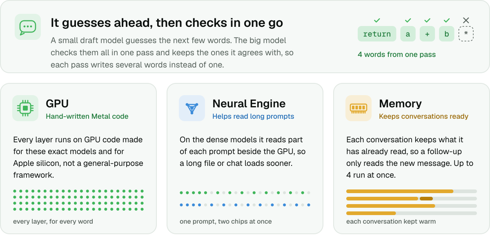

<picture>
  <source media="(max-width: 600px)" srcset="docs/assets/header-narrow.svg">
  <source media="(prefers-color-scheme: dark)" srcset="docs/assets/header-dark.svg">
  
</picture>

[Quickstart](#quickstart) · [CLI](#cli) · [Benchmarks](#benchmarks) · [Models](#models) · [Docs](docs/usage.md)

## Quickstart

**Requirements:** a Mac with Apple silicon (M1 or newer) and macOS 14 Sonoma or later.

```bash
brew install nace-ai/tap/kapitsa
# or: curl -fsSL https://raw.githubusercontent.com/nace-ai/kapitsa/main/install.sh | bash
```

```bash
kapitsa opencode --model 35b    # also: kapitsa claude, kapitsa codex, kapitsa pi
```

<sub>On a 16-24 GB Mac use `--model 9b`, or `4b` for the quickest replies.</sub>

## CLI

```bash
kapitsa serve                   # chat + OpenAI/Anthropic APIs at http://127.0.0.1:8000
kapitsa claude                  # Claude Code on Kapitsa (also: codex, opencode, pi)
kapitsa doctor                  # this Mac's GPU and memory, and which models fit it
kapitsa bench                   # benchmark this Mac, share it with the community
kapitsa pull 27b                # download a model without starting it
kapitsa list                    # downloaded models and their size
kapitsa rm 27b                  # delete a downloaded model
kapitsa import model.gguf       # use a Qwen GGUF from LM Studio, Ollama or llama.cpp
kapitsa update                  # update now (it also updates itself)
```

<sub>`--model` picks the model and its precision (`35b:6bit`). `kapitsa <command> --help` has the options.
[Usage guide](docs/usage.md)</sub>

## Benchmarks

<picture>
  <source media="(prefers-color-scheme: dark)" srcset="docs/assets/benchmarks-dark.webp">
  
</picture>

<sub>Writing speed of a coding answer, each engine in its fastest setup. 🟩 fastest per model · — not measured ·
[details](docs/benchmarks.md#the-readmes-tables)</sub>

### MacBook Pro (16-inch, 2024) · M4 Pro · 48 GB

#### Qwen

| Model | <mark>**Kapitsa**</mark> | <sub>oMLX</sub> | <sub>mlx‑serve</sub> | <sub>Ollama</sub> | <sub>MTPLX</sub> | <sub>LM&nbsp;Studio</sub> | <sub>llama.cpp</sub> | <sub>MLX</sub> | <sub>Rapid‑MLX</sub> |
| --- | ---: | ---: | ---: | ---: | ---: | ---: | ---: | ---: | ---: |
| Qwen3.5<br>4B<br><sub>4-bit</sub> | 🟩&nbsp;<mark>**179&nbsp;tok/s**</mark> | 102 | 137 | 109 | 104 | 81 | 70 | 88 | 98 |
| Qwen3.8<br>27B<br><sub>4-bit</sub> | 🟩&nbsp;<mark>**63&nbsp;tok/s**</mark> | 45 | 54 | 32 | 36 | 15 | 18 | 28 | — |
| Qwen3.6<br>35B‑A3B<br><sub>4-bit</sub> | 🟩&nbsp;<mark>**154&nbsp;tok/s**</mark> | 127 | 124 | 89 | 80 | 86 | 69 | 86 | — |

#### Nemotron

| Model | <mark>**Kapitsa**</mark> | <sub>oMLX</sub> | <sub>llama.cpp</sub> | <sub>MLX</sub> |
| --- | ---: | ---: | ---: | ---: |
| Nemotron Dory1.0 4B<br><sub>NVFP4</sub> | 🟩&nbsp;<mark>**64&nbsp;tok/s**</mark> | —<br><sub>no support</sub> | 6 | 48 |
| Nemotron 3.5 Lightning 30B‑A3B<br><sub>NVFP4</sub> | 🟩&nbsp;<mark>**106&nbsp;tok/s**</mark> | — | — | 65 |
| Nemotron 3.5 Bolt 74B‑A9B<br><sub>2/4/8-bit mix</sub> | 🟩&nbsp;<mark>**64&nbsp;tok/s**</mark> | 35 | —<br><sub>no Metal support</sub> | 32 |

### MacBook Pro (16-inch, 2026) · M5 Max · 128 GB

#### Qwen

| Model | <mark>**Kapitsa**</mark> | <sub>oMLX</sub> | <sub>mlx‑serve</sub> | <sub>Ollama</sub> | <sub>MTPLX</sub> | <sub>LM&nbsp;Studio</sub> | <sub>llama.cpp</sub> | <sub>MLX</sub> | <sub>Rapid‑MLX</sub> |
| --- | ---: | ---: | ---: | ---: | ---: | ---: | ---: | ---: | ---: |
| Qwen3.5<br>4B<br><sub>4-bit</sub> | 🟩&nbsp;<mark>**332&nbsp;tok/s**</mark> | 192 | 271 | 213 | 175 | 154 | 160 | 148 | 187 |
| Qwen3.8<br>27B<br><sub>4-bit</sub> | <mark>**102&nbsp;tok/s**</mark> | 93 | 🟩&nbsp;**130** | 68 | 69 | 32 | 51 | 54 | 61 |
| Qwen3.6<br>35B‑A3B<br><sub>4-bit</sub> | 🟩&nbsp;<mark>**281&nbsp;tok/s**</mark> | 232 | 264 | 166 | 123 | 127 | 171 | 132 | 98 |
| Qwen3.8<br>Flash‑Next<br>180B‑A7B<br><sub>4-bit</sub> | <mark>**105&nbsp;tok/s**</mark> | 107 | 🟩&nbsp;**108** | 60 | 88 | —<br><sub>won't load</sub> | 96 | 77 | —<br><sub>won't load</sub> |

#### Nemotron

| Model | <mark>**Kapitsa**</mark> | <sub>oMLX</sub> | <sub>mlx‑serve</sub> | <sub>Ollama</sub> | <sub>MTPLX</sub> | <sub>LM&nbsp;Studio</sub> | <sub>llama.cpp</sub> | <sub>MLX</sub> |
| --- | ---: | ---: | ---: | ---: | ---: | ---: | ---: | ---: |
| Nemotron Dory1.0 4B<br><sub>NVFP4</sub> | 🟩&nbsp;<mark>**117&nbsp;tok/s**</mark> | —<br><sub>no support</sub> | —<br><sub>no support</sub> | —<br><sub>no support</sub> | —<br><sub>no support</sub> | —<br><sub>no support</sub> | 9 | 76 |
| Nemotron 3.5 Lightning 30B‑A3B<br><sub>NVFP4</sub> | 🟩&nbsp;<mark>**239&nbsp;tok/s**</mark> | 190 | 190 | 153 | 131 | 110 | 159 | 139 |
| Nemotron 3.5 Bolt 74B‑A9B<br><sub>2/4/8-bit mix</sub> | 🟩&nbsp;<mark>**120&nbsp;tok/s**</mark> | 69 | —<br><sub>no support</sub> | —<br><sub>no support</sub> | —<br><sub>no support</sub> | —<br><sub>no support</sub> | —<br><sub>no Metal support</sub> | 69 |
| Nemotron 3.5 Super‑VL 120B‑A12B<br><sub>NVFP4</sub> | 🟩&nbsp;<mark>**85&nbsp;tok/s**</mark> | 52 | —<br><sub>no support</sub> | 64 | 44 | 61 | 66 | 46 |

### MacBook Pro (14-inch, 2021) · M1 Pro · 16 GB

#### Qwen

| Model | <mark>**Kapitsa**</mark> | <sub>oMLX</sub> | <sub>mlx‑serve</sub> | <sub>Ollama</sub> | <sub>MTPLX</sub> | <sub>LM&nbsp;Studio</sub> | <sub>llama.cpp</sub> | <sub>MLX</sub> | <sub>Rapid‑MLX</sub> |
| --- | ---: | ---: | ---: | ---: | ---: | ---: | ---: | ---: | ---: |
| Qwen3.5<br>4B<br><sub>4-bit</sub> | 🟩&nbsp;<mark>**85&nbsp;tok/s**</mark> | 55 | 62 | 55 | 42 | 47 | 38 | 46 | 52 |

#### Nemotron

| Model | <mark>**Kapitsa**</mark> | <sub>oMLX</sub> | <sub>llama.cpp</sub> | <sub>MLX</sub> |
| --- | ---: | ---: | ---: | ---: |
| Nemotron Dory1.0 4B<br><sub>NVFP4</sub> | 🟩&nbsp;<mark>**40&nbsp;tok/s**</mark> | —<br><sub>no support</sub> | 4 | 30 |

### MacBook Pro (16-inch, 2026) · M5 Pro · 48 GB

#### Qwen

| Model | <mark>**Kapitsa**</mark> | <sub>oMLX</sub> | <sub>mlx‑serve</sub> | <sub>Ollama</sub> | <sub>MTPLX</sub> | <sub>LM&nbsp;Studio</sub> | <sub>llama.cpp</sub> | <sub>MLX</sub> | <sub>Rapid‑MLX</sub> |
| --- | ---: | ---: | ---: | ---: | ---: | ---: | ---: | ---: | ---: |
| Qwen3.5<br>4B<br><sub>4-bit</sub> | 🟩&nbsp;<mark>**179&nbsp;tok/s**</mark> | 113 | 163 | 134 | 113 | 89 | 93 | 101 | 112 |
| Qwen3.8<br>27B<br><sub>4-bit</sub> | <mark>**61&nbsp;tok/s**</mark> | 51 | 🟩&nbsp;**71** | 40 | 41 | 17 | 30 | 32 | 35 |
| Qwen3.6<br>35B‑A3B<br><sub>4-bit</sub> | 🟩&nbsp;<mark>**167&nbsp;tok/s**</mark> | 144 | 156 | 102 | 89 | 96 | 107 | 98 | 76 |

#### Nemotron

| Model | <mark>**Kapitsa**</mark> | <sub>oMLX</sub> | <sub>mlx‑serve</sub> | <sub>Ollama</sub> | <sub>MTPLX</sub> | <sub>LM&nbsp;Studio</sub> | <sub>llama.cpp</sub> | <sub>MLX</sub> |
| --- | ---: | ---: | ---: | ---: | ---: | ---: | ---: | ---: |
| Nemotron Dory1.0 4B<br><sub>NVFP4</sub> | 🟩&nbsp;<mark>**70&nbsp;tok/s**</mark> | —<br><sub>no support</sub> | —<br><sub>no support</sub> | —<br><sub>no support</sub> | —<br><sub>no support</sub> | —<br><sub>no support</sub> | 13 | 53 |
| Nemotron 3.5 Lightning 30B‑A3B<br><sub>NVFP4</sub> | 🟩&nbsp;<mark>**136&nbsp;tok/s**</mark> | 124 | 115 | 92 | 101 | 72 | 101 | 94 |
| Nemotron 3.5 Bolt 74B‑A9B<br><sub>2/4/8-bit mix</sub> | 🟩&nbsp;<mark>**79&nbsp;tok/s**</mark> | 39 | —<br><sub>no support</sub> | —<br><sub>no support</sub> | —<br><sub>no support</sub> | —<br><sub>no support</sub> | —<br><sub>no Metal support</sub> | 41 |

<sub>Measure your Mac: `kapitsa bench --submit` adds it to the [community results](bench/community/RESULTS.md).</sub>

## Models

| Model | Download | Speculation |
| --- | --- | --- |
| **Qwen3.5-4B** · `4b`<br><sub>dense</sub> | **4-bit · 4.6 GB**<br><sub>also 6-bit 5.6 · 8-bit 6.7 · bf16 10.6 GB</sub> | DFlash / MTP |
| **Qwen3.5-9B** · `9b`<br><sub>dense</sub> | **4-bit · 9.0 GB** | DFlash / MTP |
| **Qwen3.8-27B** · `27b`<br><sub>dense</sub> | **4-bit · 20.2 GB**<br><sub>also 5-bit 23.5 · 6-bit 26.9 · 8-bit 33.6 · bf16 58.8 GB</sub> | DFlash2 / MTP |
| **Qwen3.6-35B-A3B** · `35b`<br><sub>MoE, 3B active</sub> | **4-bit · 22.1 GB**<br><sub>also 5-bit 26.4 · 6-bit 30.7 · 8-bit 39.4 · bf16 71.9 GB</sub> | DFlash2 / MTP |
| **Qwen3.8-Flash-Next 180B-A7B** · `flash-next`<br><sub>MoE, 7B active; 128 GB Macs</sub> | **4-bit · 105.9 GB**<br><sub>4/6/8-bit MLX; its 32 GB n-gram table stays on the SSD</sub> | MTP |
| **Nemotron Dory1.0 4B** · `dory`<br><sub>looped dense, 1-4 loops per token; text only</sub> | **NVIDIA NVFP4 · 3.2 GB**<br><sub>also bf16 8.0 GB</sub> | — |
| **Nemotron 3 Nano 4B** · `nano-4b`<br><sub>hybrid Mamba-2, dense; text only</sub> | **NVIDIA FP8 · 5.3 GB**<br><sub>also bf16 8.0 GB</sub> | prompt lookup |
| **Nemotron Nano 9B v2** · `nano-9b`<br><sub>hybrid Mamba-2, dense; text only</sub> | **NVIDIA NVFP4 · 7.9 GB** | prompt lookup |
| **Nemotron 3.5 Lightning 30B-A3B** · `lightning`<br><sub>hybrid Mamba-2 MoE, 3B active; text only</sub> | **NVIDIA NVFP4 · 22.9 GB**<br><sub>4-bit NVFP4 experts, FP8, BF16</sub> | DSpark |
| **Nemotron 3.5 Bolt 74B-A9B** · `bolt`<br><sub>hybrid Mamba-2 MoE, 9B active</sub> | **NVIDIA 24 GB · 25.1 GB**<br><sub>2-bit experts, NVFP4, 8-bit</sub> | LiLiCorr |
| **Nemotron 3.5 Super-VL 120B-A12B** · `super`<br><sub>hybrid Mamba-2 MoE, 12B active; 96 GB+ Macs</sub> | **NVIDIA NVFP4 · 76.4 GB**<br><sub>4-bit NVFP4 experts, FP8, BF16</sub> | LiLiCorr |

<sub>Other precisions: `--model 35b:6bit` is five times closer to bf16 than the 4-bit default ([KL](docs/benchmarks.md#quality-qwen36-35b-a3b-against-bf16-2026-10-19)). All but Lightning and Dory read images. Memory: 16 GB for the 4B models, 32 GB
for the 27B, 35B, Lightning and Bolt, 96 GB for Super-VL, 128 GB for Flash-Next. [Details](docs/usage.md#models-and-downloads)</sub>

## How it works

<picture>
  <source media="(max-width: 600px)" srcset="docs/assets/how-it-works-narrow.svg">
  <source media="(prefers-color-scheme: dark)" srcset="docs/assets/how-it-works-dark.svg">
  
</picture>

<sub>[Architecture](docs/architecture.md) · [Contributing](CONTRIBUTING.md) · [Press kit](docs/assets/brand/README.md) ·
Apache 2.0, © 2026 [Nace AI](https://nace.ai) · [Third-party notices](THIRD_PARTY_NOTICES)</sub>
