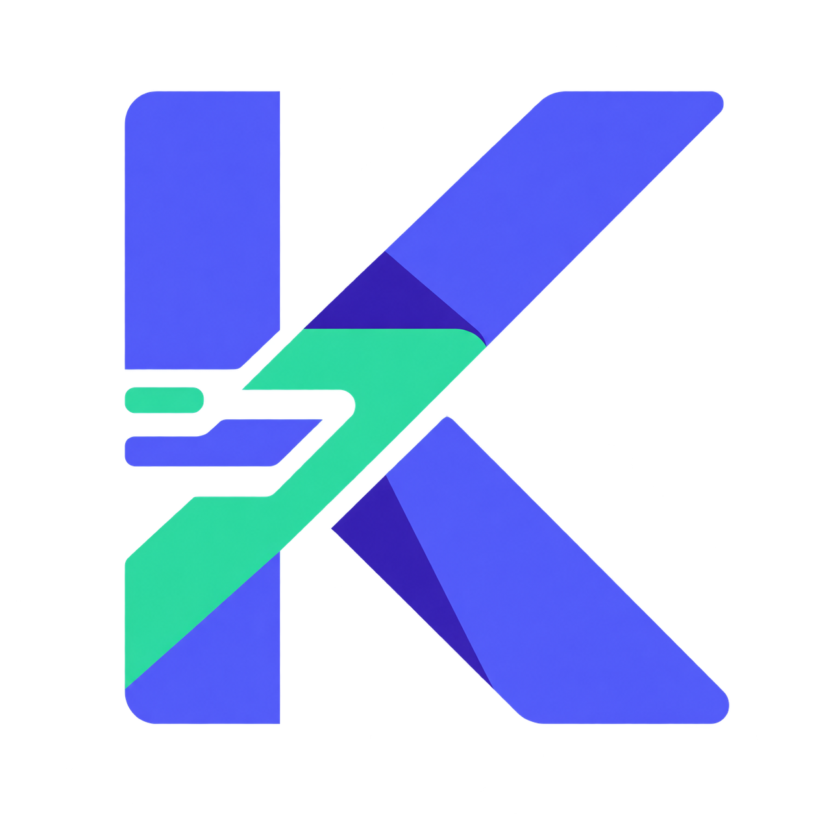

<p align="center">
  
</p>

# Kapitsa

**Local Qwen and Nemotron inference for Apple silicon, by [Nace.AI](https://nace.ai).**

Run chat apps and coding agents on your Mac through OpenAI-compatible and Anthropic-compatible APIs.
Kapitsa is a native C++ and Metal engine with speculative decoding, conversation caching, optional Neural Engine
acceleration, and image input on supported Qwen and Nemotron models.

[Quick start](#quick-start) · [Models](#models) · [Performance](#performance) · [Architecture](#architecture) · [Documentation](#documentation)

## Quick start

Use an Apple silicon Mac with macOS 15 or later, the Xcode Command Line Tools, and CMake 3.24+.
Build and install from source:

```bash
git clone https://github.com/nace-ai/kapitsa.git
cd kapitsa
./install.sh
kapitsa serve --model 4b
```

Open **http://127.0.0.1:8000** to chat. The first start downloads the model and its companion files (3.3 GB for 4B);
later starts reuse them, including offline. The 4B model fits a 16 GB Mac. Run `kapitsa doctor` to check larger models
and context sizes on your machine.

Prebuilt and Homebrew installation are prepared but not yet released. See [release status and packaging](RELEASING.md).

## Models

| Model | CLI name | Architecture | Default download | Speculation |
| --- | --- | --- | ---: | --- |
| Qwen3.5-4B | `4b` | Dense, 4B | 3.3 GB | MTP |
| Qwen3.6-35B-A3B | `35b` | MoE, 3B active | 22.1 GB | DFlash2 / MTP |
| Qwen3.8-27B | `27b` | Dense, 27B | 20.2 GB | DFlash2 / MTP |
| Nemotron 3.5 Bolt 74B-A9B | `bolt` | Hybrid Mamba-2 MoE, 9B active | 25.1 GB | LiLiCorr |

Downloads include the model's companion files. Qwen defaults to 4-bit weights; Bolt uses NVIDIA's mixed-precision
`24gb` checkpoint. Select another Qwen precision with, for example, `--model 35b:6bit`.
[Variants, checkpoints and model storage](DEVELOPMENT.md#models-and-downloads).

```bash
kapitsa serve --model bolt     # start another model (stop the current server first)
kapitsa pull 27b               # download without starting a server
kapitsa list                  # show downloaded models
```

Qwen3.6, Qwen3.8 and Nemotron 3.5 Bolt support [image input](DEVELOPMENT.md#images); 4B currently runs text only.
Compatible Qwen checkpoints can also load from a Hugging Face repo, a local folder, or a supported GGUF file.
Model weights retain their own licenses.

## Connect your apps

Launch an installed coding agent against Kapitsa:

```bash
kapitsa claude
kapitsa codex
kapitsa opencode
```

Each launcher reuses a server on port 8000 or starts one for the session. Add `--model bolt` or `--model 35b` to choose
a model. [Agent setup and options](DEVELOPMENT.md#coding-agents).

For API clients, use `http://127.0.0.1:8000/v1` for OpenAI Chat Completions and Responses, or
`http://127.0.0.1:8000` for Anthropic Messages. Streaming, reasoning and tool calls are supported.
Any API key works locally unless you start the server with `--api-key`.

<details>
<summary>Example API request</summary>

```bash
curl http://127.0.0.1:8000/v1/chat/completions \
  -H 'Content-Type: application/json' \
  -d '{
    "model": "qwen3.5-4b",
    "messages": [{"role": "user", "content": "Explain speculative decoding."}],
    "reasoning_effort": "none"
  }'
```

</details>

Use `--ctx` to set context length and `--mem-budget` to limit GPU memory. `--slots` keeps conversations cached;
it does not enable parallel generation. [All server options and API details](DEVELOPMENT.md#server).

## Performance

**M5 Max · 40-core GPU · 128 GB · macOS 26.4 · AC power.** Median generation speed from five 512-token coding
answers at each temperature. Source revision and full conditions are recorded in the
[M5 Max report](docs/benchmarks-m5-max.md).

| Model | Sampled (T=0.6) | Greedy (T=0) | Peak memory |
| --- | ---: | ---: | ---: |
| Qwen3.6-35B-A3B | 249.8 tok/s | 297.4 tok/s | 21.0 GiB |
| Qwen3.8-27B | 72.9 tok/s | 83.7 tok/s | 19.4 GiB |

Both published runs passed the harness checks and were flagged for **background GPU contention**.

These are text-generation throughput measurements, not model-quality scores. The linked report includes prompt
processing, cached latency, correctness checks and raw results. For other engines on the M4 Pro, see the
[comparison report](docs/benchmarks.md). [Run the benchmarks yourself](bench/harness/README.md).

## Architecture



* **Specialized kernels** execute each model's attention, recurrent layers and matrix operations directly in Metal.
* **Speculative decoding** drafts multiple tokens, then verifies them with the target model.
* **Conversation caching** reuses attention KV caches and recurrent-state checkpoints for follow-up turns.

[Architecture walkthrough and source map](docs/architecture.md) · [Optimization measurements](docs/PERF.md)

## Documentation

* [Development guide](DEVELOPMENT.md): builds, APIs, images, model formats, memory and tuning.
* [Benchmark methodology](bench/harness/README.md): reproducible measurements and validity checks.
* [Contributing](CONTRIBUTING.md) · [Security](SECURITY.md) · [Releases](RELEASING.md)

Kapitsa is licensed under [Apache 2.0](LICENSE), copyright 2026 Nace AI.
[Third-party notices and acknowledgments](THIRD_PARTY_NOTICES) cover included and adapted code.
