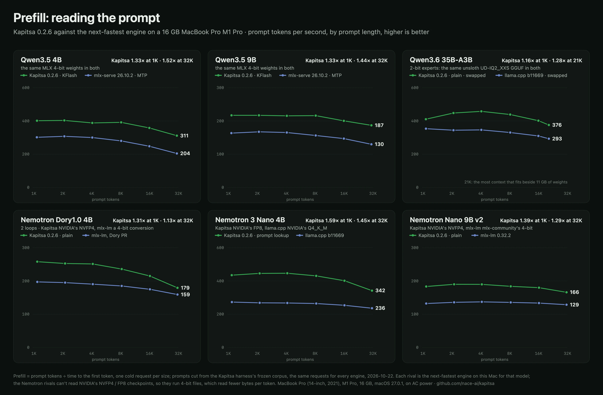
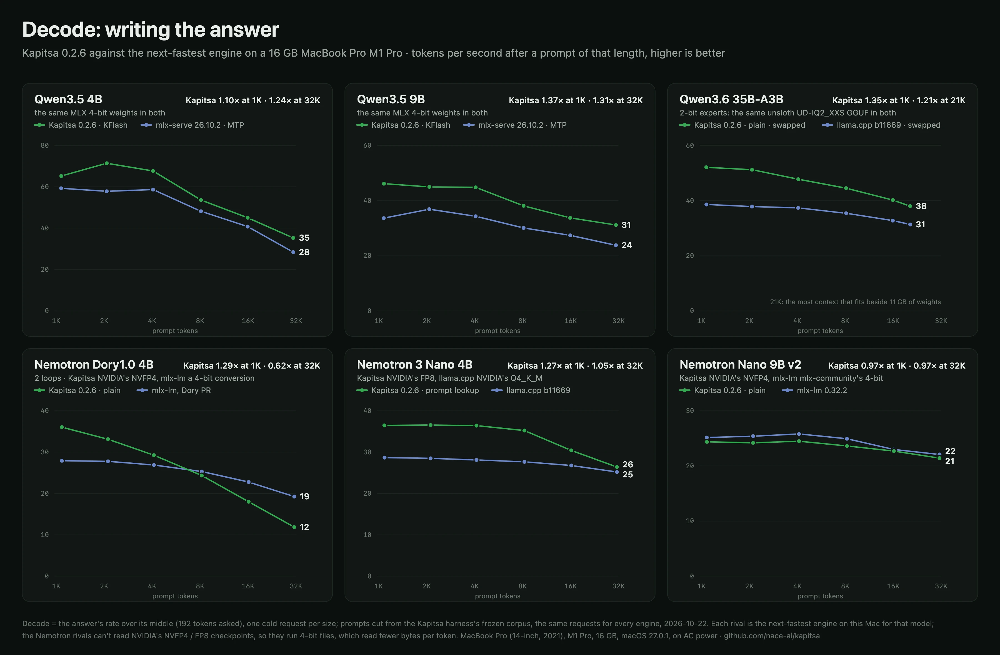

# Results, 2026-10-22: MacBook Pro M1 Pro, 16 GB, prompt length 1K to 32K

Kapitsa 0.2.6 against the next-fastest engine for each of the six catalog models that fit this Mac, from a 1K- to a
32K-token prompt: the harness's sweep phase (`bench/harness/agentic.py`, `t_sweep`). The Mac of
[2026-10-19](../2026-10-19-m1pro-16gb/README.md): a MacBook Pro (14-inch, 2021), `MacBookPro18,3`, M1 Pro with an 8-core
CPU and a 14-core GPU, 16 GB, macOS 27.0.1 (26A434), on AC power (Automatic power mode). Times are local (UTC+5). The
same day's `kapitsa bench` runs of these models (the README's M1 Pro cells) are in
[docs/benchmarks.md](../../../docs/benchmarks.md#macbook-pro-m1-pro-16-gb-kapitsa-026-2026-10-22).





## How it ran

Each point is one cold request: a prompt cut from the frozen corpus to about 1K, 2K, 4K, 8K, 16K and 32K tokens (the
largest that fits a 32K context with the answer), then a 192-token answer. Prefill is the prompt tokens over the time
to the first token; decode is the answer's rate over the middle of its stream. Every engine got the same requests,
one engine at a time under the GPU lock, after the harness's warm-up and quiet-GPU wait, with the other phases
skipped:

```bash
python3 bench/harness/compare_engines.py bench/harness/configs/*.json \
  bench/results/2026-10-19-m1pro-16gb/tuning/m1-tuning.json bench/results/2026-10-19-m1pro-16gb/qwen3.5-9b/q35-9b.json \
  bench/results/2026-10-22-m1pro-16gb/m1-sweep.json --only '<label>' --agentic \
  --bench-args "--skip decode,greedy,prefill,tools,agent,cache,sustain --sweep-repeats 1"
```

The labels and their settings are in [m1-sweep.json](m1-sweep.json). One request per size keeps the run short; this
Mac's repeated runs of one build spread 3-8% at T = 0.6, so read a single point's ratio within that. The 35B with
2-bit experts stops at 20,952 tokens (`--max-ctx 22000`): the most context its KV cache fits beside 11 GB of weights.

| Model | Kapitsa 0.2.6 (the release, catalog default) | Rival: the next-fastest engine here | Weights |
| --- | --- | --- | --- |
| Qwen3.5-4B | KFlash (DFlash drafter) | mlx-serve 26.10.2, MTP max depth 2 | the same MLX 4-bit trunk (mlx-serve's pack clones it and adds mlx-community's 4-bit MTP head) |
| Qwen3.5-9B | KFlash (DFlash drafter) | mlx-serve 26.10.2, MTP max depth 2 | the same, with the 9B's head |
| Qwen3.6-35B-A3B | plain | llama.cpp b11669 | unsloth's UD-IQ2_XXS GGUF (`a483e9e`, sha256 checked) in both |
| Nemotron Dory1.0 4B | plain, 2 loops, last-loop KV | mlx-lm with its Dory pull request (#1988 at `208065f`, mlx 0.32.4), per-loop KV | NVIDIA's NVFP4 / snsnc's MLX 4-bit (`d3b6295`) |
| Nemotron 3 Nano 4B | prompt lookup | llama.cpp b11669 | NVIDIA's FP8 / NVIDIA's Q4_K_M GGUF (`ba223d1`) |
| Nemotron Nano 9B v2 | plain | mlx-lm 0.32.2 (mlx 0.32.4) | NVIDIA's NVFP4 / mlx-community's 4-bit (`863ab70`) |

The rivals are the engines next to Kapitsa on this Mac in the 2026-10-19 runs. On the Nemotron models they read other
weights than Kapitsa: they don't read NVIDIA's NVFP4 or FP8 checkpoints, and their 4-bit files read fewer bytes per
token (the Nano 9B v2: 5.0 GB against 6.1), which favors them on decode. The README's MLX cell for the Nano 9B v2 is
mlx-lm on NVIDIA's NVFP4 (18 tok/s); here it ran the 4-bit file a user would download for it.

## What the sweep says

- **Prefill: Kapitsa reads faster at every size on all six models**, 1.13-1.67x. The Qwen models' lead grows with the
  prompt (the 4B 1.33x at 1K to 1.52x at 32K, the 9B 1.33x to 1.44x); the Nemotron models' shrinks (Dory 1.31x to
  1.13x, the Nano 4B 1.59x to 1.45x, the Nano 9B v2 1.39x to 1.29x).
- **Decode: Kapitsa is ahead on the Qwen models at every size** (the 4B 1.10-1.24x, the 9B 1.22-1.37x, the 35B
  1.21-1.35x on the same file) **and behind where its rival reads fewer bytes or its own decode falls off with the
  context**: on Dory it leads to 4K (1.29x at 1K) and trails from 8K (0.62x at 32K: 11.9 against 19.3 tok/s); on the
  Nano 4B its lead goes from 1.27x at 1K to 1.05x at 32K; on the Nano 9B v2 it is 0.95-0.99x throughout.
- **Kapitsa's decode loses more to long prompts on the Nemotron models**: from 1K to 32K, Dory -67% (mlx-lm -31%),
  the Nano 4B -28% (llama.cpp -12%), the Nano 9B v2 -12% (mlx-lm -12%). On the Qwen models both engines fall alike
  (the 4B -46% / -52%, the 9B -33% / -29%).
- **Memory: Kapitsa's peak is lower on every model**: the 4B 5.2 against 6.6 GB, the 9B 8.3 against 8.6, the 35B 11.7
  against 14.6, Dory 4.4 against 11.5, the Nano 4B 5.2 against 7.8, the Nano 9B v2 7.3 against 10.6 (the server's
  `phys_footprint_peak`, GB of 2^30 bytes).
- **mlx-serve answered the 9B's 16K and 32K prompts** (147 and 130 tok/s), which it refused on 2026-10-19 ("requires
  ~1636MB GPU memory but only ~958MB is available").

## Kapitsa against the rival, size by size

**Qwen3.5-4B, 4-bit**: Kapitsa 0.2.6 against mlx-serve 26.10.2 (MTP, max depth 2)

| Prompt | Prefill, Kapitsa (tok/s) | Prefill, rival | Kapitsa / rival | Decode, Kapitsa (tok/s) | Decode, rival | Kapitsa / rival |
| ---: | ---: | ---: | ---: | ---: | ---: | ---: |
| 1K (1,105 tok) | 402 | 302 | 1.33× | 65.2 | 59.3 | 1.10× |
| 2K (2,129 tok) | 403 | 308 | 1.31× | 71.4 | 57.8 | 1.23× |
| 4K (4,157 tok) | 388 | 300 | 1.29× | 67.6 | 58.7 | 1.15× |
| 8K (8,305 tok) | 392 | 280 | 1.40× | 53.6 | 48.2 | 1.11× |
| 16K (16,309 tok) | 358 | 248 | 1.44× | 45.0 | 40.8 | 1.10× |
| 32K (31,550 tok) | 311 | 204 | 1.52× | 35.3 | 28.4 | 1.24× |

**Qwen3.5-9B, 4-bit**: Kapitsa 0.2.6 against mlx-serve 26.10.2 (MTP, max depth 2)

| Prompt | Prefill, Kapitsa (tok/s) | Prefill, rival | Kapitsa / rival | Decode, Kapitsa (tok/s) | Decode, rival | Kapitsa / rival |
| ---: | ---: | ---: | ---: | ---: | ---: | ---: |
| 1K (1,105 tok) | 217 | 163 | 1.33× | 46.1 | 33.6 | 1.37× |
| 2K (2,130 tok) | 217 | 167 | 1.30× | 45.0 | 36.9 | 1.22× |
| 4K (4,158 tok) | 215 | 165 | 1.30× | 44.8 | 34.3 | 1.31× |
| 8K (8,306 tok) | 216 | 156 | 1.38× | 38.1 | 30.1 | 1.27× |
| 16K (16,310 tok) | 200 | 147 | 1.36× | 33.7 | 27.4 | 1.23× |
| 32K (31,551 tok) | 187 | 130 | 1.44× | 31.1 | 23.8 | 1.31× |

**Qwen3.6-35B-A3B, 2-bit experts**: Kapitsa 0.2.6 against llama.cpp b11669, the same GGUF<sup>1</sup>

| Prompt | Prefill, Kapitsa (tok/s) | Prefill, rival | Kapitsa / rival | Decode, Kapitsa (tok/s) | Decode, rival | Kapitsa / rival |
| ---: | ---: | ---: | ---: | ---: | ---: | ---: |
| 1K (1,101 tok) | 411 | 354 | 1.16× | 52.1 | 38.6 | 1.35× |
| 2K (2,132 tok) | 448 | 344 | 1.30× | 51.2 | 37.8 | 1.35× |
| 4K (4,159 tok) | 458 | 346 | 1.32× | 47.7 | 37.3 | 1.28× |
| 8K (8,306 tok) | 439 | 330 | 1.33× | 44.5 | 35.4 | 1.26× |
| 16K (16,310 tok) | 402 | 310 | 1.30× | 40.2 | 32.7 | 1.23× |
| 21K (20,952 tok) | 376 | 293 | 1.28× | 38.0 | 31.3 | 1.21× |

**Nemotron Dory1.0 4B**: Kapitsa 0.2.6 against mlx-lm, Dory PR #1988 (4-bit, per-loop KV)<sup>2</sup>

| Prompt | Prefill, Kapitsa (tok/s) | Prefill, rival | Kapitsa / rival | Decode, Kapitsa (tok/s) | Decode, rival | Kapitsa / rival |
| ---: | ---: | ---: | ---: | ---: | ---: | ---: |
| 1K (1,112 tok) | 258 | 197 | 1.31× | 36.0 | 27.9 | 1.29× |
| 2K (2,167 tok) | 253 | 195 | 1.30× | 33.1 | 27.8 | 1.19× |
| 4K (4,206 tok) | 251 | 190 | 1.32× | 29.3 | 26.9 | 1.09× |
| 8K (8,414 tok) | 236 | 185 | 1.27× | 24.3 | 25.3 | 0.96× |
| 16K (16,541 tok) | 215 | 175 | 1.23× | 18.0 | 22.8 | 0.79× |
| 32K (32,005 tok) | 179 | 159 | 1.13× | 11.9 | 19.3 | 0.62× |

**Nemotron 3 Nano 4B**: Kapitsa 0.2.6 against llama.cpp b11669 (NVIDIA's Q4_K_M)

| Prompt | Prefill, Kapitsa (tok/s) | Prefill, rival | Kapitsa / rival | Decode, Kapitsa (tok/s) | Decode, rival | Kapitsa / rival |
| ---: | ---: | ---: | ---: | ---: | ---: | ---: |
| 1K (1,111 tok) | 435 | 273 | 1.59× | 36.5 | 28.7 | 1.27× |
| 2K (2,167 tok) | 446 | 269 | 1.66× | 36.6 | 28.5 | 1.28× |
| 4K (4,207 tok) | 446 | 268 | 1.67× | 36.4 | 28.1 | 1.30× |
| 8K (8,412 tok) | 431 | 264 | 1.63× | 35.2 | 27.7 | 1.27× |
| 16K (16,543 tok) | 402 | 254 | 1.58× | 30.4 | 26.8 | 1.14× |
| 32K (32,006 tok) | 342 | 236 | 1.45× | 26.4 | 25.2 | 1.05× |

**Nemotron Nano 9B v2**: Kapitsa 0.2.6 against mlx-lm 0.32.2 (mlx-community 4-bit)

| Prompt | Prefill, Kapitsa (tok/s) | Prefill, rival | Kapitsa / rival | Decode, Kapitsa (tok/s) | Decode, rival | Kapitsa / rival |
| ---: | ---: | ---: | ---: | ---: | ---: | ---: |
| 1K (1,110 tok) | 183 | 132 | 1.39× | 24.4 | 25.1 | 0.97× |
| 2K (2,165 tok) | 190 | 136 | 1.40× | 24.2 | 25.4 | 0.95× |
| 4K (4,206 tok) | 190 | 137 | 1.38× | 24.5 | 25.8 | 0.95× |
| 8K (8,410 tok) | 184 | 136 | 1.36× | 23.6 | 24.9 | 0.95× |
| 16K (16,542 tok) | 180 | 133 | 1.35× | 22.7 | 23.0 | 0.99× |
| 32K (32,006 tok) | 166 | 129 | 1.29× | 21.4 | 22.1 | 0.97× |

1. Both engines' sweeps swapped (Kapitsa 36,072 pages, llama.cpp 207,104): a 11.7 and a 14.6 GB server beside the
   open apps (Chrome, Apple Intelligence's on-device model and the desktop app driving the runs).
2. mlx-lm's sweep swapped 1,208 pages.

## Result files

The runs are in [results/](results/), the server logs in [logs/](logs/). Paths are written as `<scratch>` (the run's
output folder), `{repo}`, `{models}` and `~`. Swap is the pages swapped out during the sweep; nothing was flagged for
contention.

| Result file | Started | Run | Pages swapped out | Other apps' GPU (mean / max %) | Flags |
| --- | --- | --- | ---: | ---: | --- |
| `sw-q35-4b-kapitsa-20261022-121559.json` | 12:16 | Kapitsa 0.2.6 (KFlash, catalog 4b) | 0 | 0.0 / 0 | – |
| `sw-q35-4b-mlxserve-mtp-d2-20261022-125600.json` | 12:57 | mlx-serve + MTP (max depth 2) | 0 | 0.0 / 0 | – |
| `sw-q35-9b-kapitsa-20261022-123517.json` | 12:36 | Kapitsa 0.2.6 (KFlash, catalog 9b) | 0 | 0.0 / 0 | – |
| `sw-q35-9b-mlxserve-mtp-d2-20261022-130224.json` | 13:04 | mlx-serve + MTP (max depth 2) | 0 | 0.1 / 25.0 | – |
| `sw-q36-35b-16gb-kapitsa-20261022-123148.json` | 12:32 | Kapitsa 0.2.6 (plain, catalog 35b:16gb) | 36072 | 0.0 / 0 | sweep: 36072 pages swapped out during the phase |
| `sw-q36-35b-16gb-llamacpp-20261022-133946.json` | 13:40 | llama.cpp b11669 (UD-IQ2_XXS GGUF) | 207104 | 0.0 / 0 | sweep: 207104 pages swapped out during the phase |
| `sw-dory-kapitsa-20261022-122435.json` | 12:25 | Kapitsa 0.2.6 (2 loops, last-loop KV, catalog dory) | 0 | 0.0 / 0 | – |
| `sw-dory-mlxlm-4bit-20261022-131240.json` | 13:13 | mlx-lm (PR #1988, 4-bit, 2 loops, per-loop KV) | 1208 | 0.0 / 0 | sweep: 1208 pages swapped out during the phase |
| `sw-nano-4b-kapitsa-20261022-122019.json` | 12:21 | Kapitsa 0.2.6 (prompt lookup, catalog nano-4b) | 0 | 0.0 / 0 | – |
| `sw-nano-4b-llamacpp-20261022-124221.json` | 12:50 | llama.cpp b11669 (NVIDIA's Q4_K_M GGUF) | 0 | 0.0 / 0 | – |
| `sw-nano-9b-kapitsa-20261022-133131.json` | 13:32 | Kapitsa 0.2.6 (catalog nano-9b) | 0 | 0.08 / 16.65 | – |
| `sw-nano-9b-mlxlm-4bit-20261022-132059.json` | 13:22 | mlx-lm 0.32.2 (mlx-community 4-bit) | 0 | 0.0 / 0.52 | – |

The rivals' weights downloaded (at most ~11 MB/s in all) during the sweeps of 12:16-12:57: Kapitsa's 4B, Nano 4B,
Dory, 35B and 9B and llama.cpp's Nano 4B. Of those only the 35B's swapped, and none was flagged for contention.
