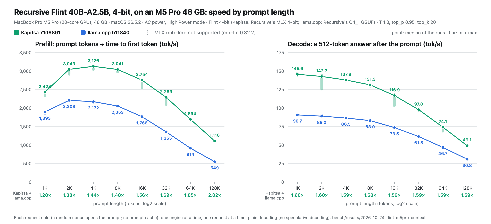

# Flint 40B-A2.5B by prompt length on the M5 Pro 48 GB (2026-10-24)

Prefill and decode speed of Recursive Flint 40B-A2.5B at 4-bit against the prompt's length, from 1K to 128K tokens, on
Kapitsa and llama.cpp. Each point is the median of 3 or more cold requests, and the bars and the `min-max` rows give
their spread.

| Prefill (tok/s) | 1K | 2K | 4K | 8K | 16K | 32K | 64K | 128K |
| --- | ---: | ---: | ---: | ---: | ---: | ---: | ---: | ---: |
| Kapitsa 71d6891 | 2,428 | 3,043 | 3,126 | 3,041 | 2,754 | 2,289 | 1,694 | 1,110 |
| llama.cpp b11840 | 1,893 | 2,208 | 2,172 | 2,053 | 1,766 | 1,355 | 914 | 549 |
| MLX (mlx-lm) | not supported (mlx-lm 0.32.2) | × | × | × | × | × | × | × |
| Kapitsa 71d6891: min-max (runs) | 2,326-2,432 (5) | 2,909-3,057 (5) | 3,038-3,140 (5) | 2,970-3,045 (5) | 2,544-2,766 (5) | 2,093-2,300 (5) | 1,691-1,701 (3) | 1,104-1,112 (3) |
| llama.cpp b11840: min-max (runs) | 1,837-1,896 (5) | 2,203-2,210 (5) | 2,151-2,174 (5) | 2,036-2,055 (5) | 1,764-1,768 (5) | 1,350-1,356 (5) | 914-914 (3) | 544-551 (4) |
| Kapitsa ÷ llama.cpp | 1.28× | 1.38× | 1.44× | 1.48× | 1.56× | 1.69× | 1.85× | 2.02× |

| Decode (tok/s) | 1K | 2K | 4K | 8K | 16K | 32K | 64K | 128K |
| --- | ---: | ---: | ---: | ---: | ---: | ---: | ---: | ---: |
| Kapitsa 71d6891 | 145.6 | 142.7 | 137.8 | 131.3 | 116.9 | 97.8 | 74.1 | 49.1 |
| llama.cpp b11840 | 90.7 | 89.0 | 86.5 | 83.0 | 73.5 | 61.5 | 46.7 | 30.8 |
| MLX (mlx-lm) | not supported (mlx-lm 0.32.2) | × | × | × | × | × | × | × |
| Kapitsa 71d6891: min-max (runs) | 144.1-146.8 (5) | 125.5-144.5 (5) | 136.1-139.3 (4) | 129.2-132.7 (4) | 102.9-118.2 (5) | 96.6-98.2 (5) | 68.5-74.4 (3) | 49.0-49.6 (3) |
| llama.cpp b11840: min-max (runs) | 90.2-91.0 (4) | 88.6-90.3 (4) | 86.4-86.7 (3) | 82.7-83.0 (5) | 73.0-73.7 (5) | 61.4-61.7 (5) | 46.7-46.7 (3) | 29.9-31.0 (4) |
| Kapitsa ÷ llama.cpp | 1.60× | 1.60× | 1.59× | 1.58× | 1.59× | 1.59× | 1.59× | 1.59× |

## Setup

- **Mac.** MacBook Pro Mac17,8, M5 Pro (20-core GPU), 48 GB, macOS 26.5.2, on AC power in High Power mode. One engine
  and one request at a time, under the GPU lock (`lockf -k /tmp/kapitsa-gpu.lock`).
- **Kapitsa** `71d6891` (main, 0.2.15), Release build, on Recursive's MLX 4-bit export (`RecursiveSI/flint-int4`
  @`3b93f905`, 22.6 GB): `NI_DISK_CACHE=0 kapitsa serve --model-id flint --ctx 262144 --slots 1`. These are its defaults
  for Flint: plain decoding (no drafter, prompt lookup off), prefill attention on the matrix units (`NI_FLINT_QATTN`, #345).
- **llama.cpp** b11840 (`36e36e63a`, the release binary) on Recursive's Q4_1 GGUF (`RecursiveSI/flint-int4-gguf`
  @`9c471510`, `flint-int4-q4_1.gguf`, 26.0 GB, sha256 `43c07bac…a4b`): `llama-server -c 140000 -np 1 -ngl 999 -fa on
  -ctk f16 -ctv f16 -b 2048 -ub 2048 --cache-ram 0 -lm none -lzm off --jinja`. `-b/-ub 2048` as in the earlier Flint
  runs, not the card's 256/128. The GGUF was read from the external SSD without mmap (`-lm none`; b11840 has no `--no-mmap`,
  and `-lzm off` keeps every tensor resident), so the weights were in memory before the warm-up and no timed request
  read them from a disk.
- **mlx-lm** was not run: mlx-lm 0.32.2 (the newest on PyPI) has no Flint model (`mlx_lm/models/flint.py` does not exist).

## Method

- **Prompt.** A system message, `[session <random 16-hex nonce>] You are a coding assistant working in this
  repository.` followed by `bench/corpus.txt` and the `src/`, `tools/` and `docs/` files of `71d6891` in path order
  (1.95M Flint tokens) cut to N − 60 tokens with Flint's tokenizer; then one user question asking to explain the code.
  N is the point's size (1K = 1,024); `usage.prompt_tokens` came out 14-18 tokens under N. Every request gets a new
  nonce at the start, so no prompt prefix is reused, and both engines had their prompt caches off (`NI_DISK_CACHE=0`,
  `--cache-ram 0`). Both engines get the same text apart from the nonce.
- **Answer.** `max_tokens` 512, streamed, at Flint's card settings T 1.0, top_p 0.95, top_k 20.
- **Prefill** = `usage.prompt_tokens` ÷ time from sending the request to the first streamed token (TTFT).
- **Decode** = the answer's rate from the 16th token to the 4th from last (bench/harness/bench.py's `decode_rates`); the
  end-to-end rate from the first token is in the raw data too (`decode_tps_e2e`).
- **Runs.** 1K to 32K: five runs per size, the sizes in turn (1K, 2K, … 32K, then again), in one server load per engine.
  64K and 128K: three runs each on Kapitsa, in turn in one server load; on llama.cpp, 64K in one load (its 128K request
  there would have ended past the leg's 570 s, so it was not started) and 128K in two loads of two runs, so four runs.
  Every load starts with a 2K warm-up request that is not counted. Each GPU leg was held under 10 minutes (a request that would end past 570 s was not started), and the server
  was stopped if swap grew over 256 MB in a leg; it never did. A leg started only with 40% of memory free and no
  other process over 2 GB resident (the llama.cpp legs; the agent host's own process excepted).
- **Left out.** A decode value is left out when the model ended its answer before 256 tokens, and any value when other
  processes used over 5% of the GPU in its window (`gpu_hogs.py monitor`). The left-out runs and why are in
  `summary.json`; their numbers stay in `raw/`.

## Files

- `raw/<engine>-<leg>/runs.json`: every request (prompt tokens, TTFT, completion tokens, both decode rates, swap before
  and after, foreign GPU load per window, and the stream's event times and character counts, so other windows can be
  recomputed); `warm.json`, the warm-up; `leg.log`, `server.log`, `foreign_gpu.txt`, `vmstat_*.txt`, `footprint_end.txt`.
- `summary.json`, `table.md`, `flint-m5pro-context.{svg,png}`: written by `python3 make_chart.py --png` from `raw/`.
- `sweep/`: `ctx_sweep.py` (the requests), `leg.sh` (one GPU leg) and `driver.sh` (llama.cpp's legs in sequence), as run
  from a scratch directory.

## Findings

- **Prefill.** Kapitsa reads the prompt faster than llama.cpp at every length, and the lead grows with the length: 1.28x
  at 1K, 1.44x at 4K, 1.69x at 32K, 2.02x at 128K (1,110 against 549 tok/s). Both peak at 2K to 4K; at 128K Kapitsa
  keeps 36% of its peak, llama.cpp 25%.
- **Decode.** Kapitsa decodes 1.58-1.60x as fast as llama.cpp at every length, 145.6 against 90.7 tok/s at 1K and 49.1
  against 30.8 at 128K. Both lose 66% from 1K to 128K, so the ratio does not move with the length.
- **Against the earlier M5 Pro sweep** ([2026-10-22-flint-m5pro](../2026-10-22-flint-m5pro/README.md#context-sweep-1k-to-128k-tokens),
  Kapitsa `6c13588`, one cold run per point, 256-token answers): Kapitsa's prefill is 2.1x higher at 1K, 2.4x at 4K and
  3.2x at 128K (350 → 1,110 tok/s), which turns the 0.60-0.64x it had against llama.cpp there into 1.28-2.02x. That comes from the changes between `6c13588` and `71d6891`, #345 (prefill
  attention on the matrix units) among them; how much each gives was not measured here. Its decode is within 6%. llama.cpp b11840
  reads and decodes within 4% of b11804 at every length.
- **Spread.** llama.cpp's runs agree within 4% at every point. Kapitsa's prefill runs agree within 1% at 64K and 128K
  and within 3-10% below that, where the third round of the 1K-32K leg was slower at several sizes; its decode at 2K,
  16K and 64K each has one slow run (125.5, 102.9 and 68.5 tok/s) that the median leaves aside.
- **Left out.** Six decode values, for answers that ended before 256 tokens: Kapitsa 4K (125 tokens) and 8K (225), and
  llama.cpp 1K (135), 2K (172) and 4K twice (143, 163). Every cell keeps 3 runs or more. Other processes never used over
  5% of the GPU in a window (the most: NotificationCenter, 3.6% in one llama.cpp 128K prefill), so no value was left out
  for load. Swap did not grow in any request.
- **Not run.** mlx-lm (no Flint model in 0.32.2); 256K, which Kapitsa supports (`--ctx 262144`) but one request of which
  would not finish inside a 10-minute leg on llama.cpp, and llama.cpp's `-c 140000` stops at 128K.

