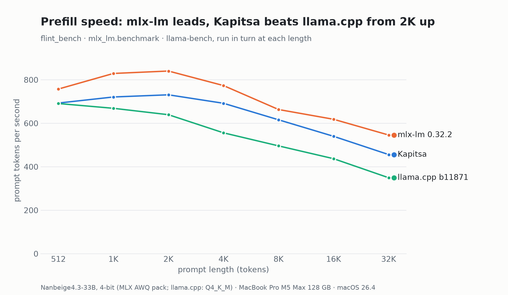
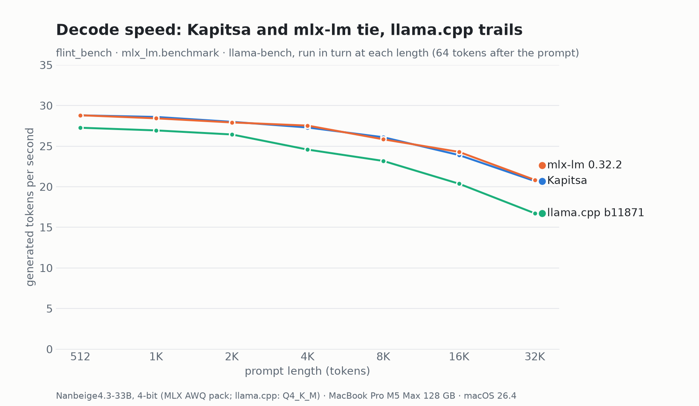
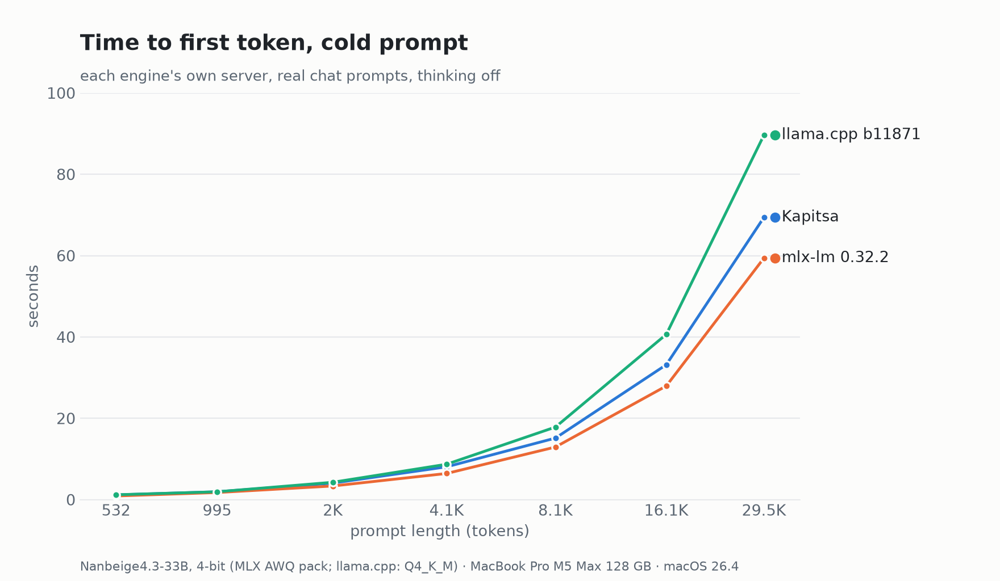
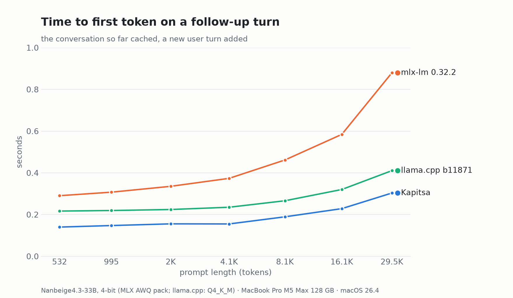

# M5 Max, 128 GB: Nanbeige4.3-33B from 512 to 32K tokens on Kapitsa, mlx-lm and llama.cpp, 2026-10-26

All runs used one MacBook Pro M5 Max with 128 GB, on macOS 26.4 (25E246), on AC power in High Power mode. The engines ran
in turn. The weights are the same as [the 2026-10-25 session](../2026-10-25-m5-max-nanbeige/README.md):

- Kapitsa and mlx-lm 0.32.2 read the catalog's 4-bit AWQ pack, kapitsaprime/Nanbeige4.3-33B-MLX-4bit @ 5901f0d4.
- llama.cpp b11871 reads Q4_K_M.

Kapitsa is main 0156392 plus #682, which moves the drafter's prompt commit behind the trunk's command buffer. The
binary reports 7886832, the commit it was configured at. It runs with the DFlash2 drafter that `kapitsa pull nanbeige`
now downloads next to the model (#657, #658).

The Claude desktop app was open during the runs and drew up to 7% of the GPU. Over Kapitsa's harness run the mean was
0.4%, with a single peak at 22%.

## Context sweep: each engine's own benchmark tool

`../2026-10-25-m5-max-nanbeige/context-sweep/sweep.sh` ran each engine at every prompt length, one after another:

- Kapitsa: `flint_bench --prompt N --steps 64`.
- mlx-lm: `mlx_lm.benchmark -p N -g 64`.
- llama.cpp: `llama-bench -fa 1`, with decode measured at depth N.

The raw outputs are in `context-sweep/`, and `context-sweep/sweep_table.py context-sweep` prints the tables from them.
The flint_bench rows run without the drafter.

| Context | Prefill: Kapitsa | mlx-lm | llama.cpp | Decode: Kapitsa | mlx-lm | llama.cpp |
| ---: | ---: | ---: | ---: | ---: | ---: | ---: |
| 512 | 693 | **757** | 691 | 28.8 | 28.8 | 27.3 |
| 1K | 721 | **829** | 669 | **28.6** | 28.4 | 26.9 |
| 2K | 731 | **840** | 639 | **28.0** | 27.9 | 26.4 |
| 4K | 692 | **773** | 556 | 27.3 | **27.5** | 24.6 |
| 8K | 616 | **663** | 496 | **26.1** | 25.8 | 23.2 |
| 16K | 540 | **618** | 437 | 23.9 | **24.3** | 20.4 |
| 32K | 456 | **546** | 349 | 20.7 | **20.8** | 16.7 |

 

## Real chat prompts: the harness at seven sizes

The command was `bench/harness/compare_engines.py configs/nanbeige.json --only kapitsa,mlxlm,llamacpp --skip agent
--sizes 400,800,1600,3200,6400,12800,24000`. It sends real chat requests with thinking off, T 0.6. The records are in
`harness/`.

- **Cold** is the time to the first token of a new prompt.
- **Follow-up** is the time to the first token when a new user turn is added to the cached conversation (`turn2_ttft_s`).

| Prompt tokens | Cold: Kapitsa | mlx-lm | llama.cpp | Follow-up: Kapitsa | mlx-lm | llama.cpp |
| ---: | ---: | ---: | ---: | ---: | ---: | ---: |
| 532 | 1.18 s | **0.90 s** | 1.20 s | **0.14 s** | 0.29 s | 0.22 s |
| 995 | 1.94 s | **1.75 s** | 1.94 s | **0.15 s** | 0.31 s | 0.22 s |
| 2,038 | 4.07 s | **3.36 s** | 4.28 s | **0.16 s** | 0.34 s | 0.22 s |
| 4,129 | 8.08 s | **6.44 s** | 8.71 s | **0.15 s** | 0.37 s | 0.24 s |
| 8,106 | 15.1 s | **12.9 s** | 17.9 s | **0.19 s** | 0.46 s | 0.27 s |
| 16,101 | 33.2 s | **28.0 s** | 40.7 s | **0.23 s** | 0.58 s | 0.32 s |
| 29,499 | 69.4 s | **59.4 s** | 89.7 s | **0.30 s** | 0.88 s | 0.41 s |

 

| Engine | Decode T=0.6 (tok/s) | Decode greedy (tok/s) | Prefill 4K / 16K (tok/s) | Peak memory (GB) | Tools |
| --- | ---: | ---: | ---: | ---: | --- |
| **Kapitsa** 0156392 + #682 | **28.1** (27.5-31.7) | 27.6 | 511 / 485 | **28.1** | pass |
| mlx-lm 0.32.2 | 27.3 (27.3-27.3) | **27.7** | **641 / 576** | 52.1 | pass |
| llama.cpp b11871 | 25.3 (25.2-25.4) | 25.2 | 474 / 396 | 41.6 | pass |

Against the 2026-10-25 session:

- Kapitsa (28.8 / 532 then) and llama.cpp (25.9 / 496) are 2-4% lower on both decode and 4K prefill.
- mlx-lm's server is 1% higher on decode (27.0 then) and 4% lower on prefill (668).

On the harness's decode prompt the drafter mostly falls back to plain decoding (about 1.1 tokens per cycle).

The README poster's Nanbeige row takes its Kapitsa and llama.cpp cells from this run.
