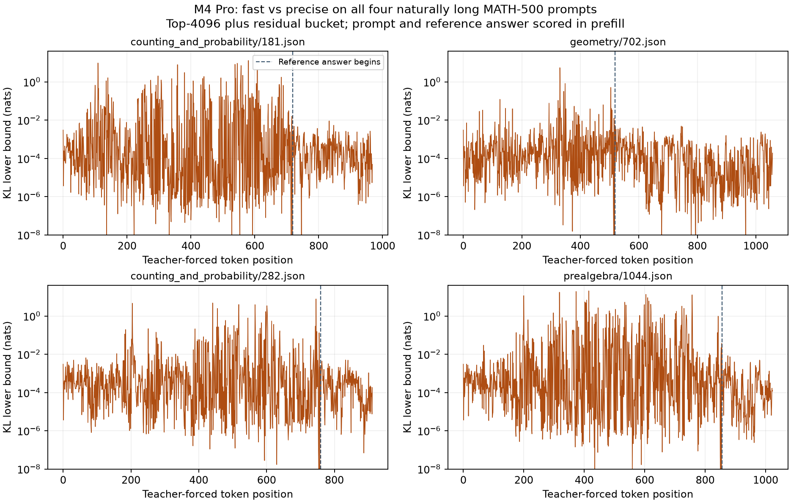

# Qwen3.5 9B: long-prompt reasoning and per-position KL

This is a small, deliberately ANE-exposed diagnostic, not a quality-equivalence claim. Selection was fixed before outcomes: all four MATH500 problems whose actual thinking-enabled chat prompt exceeded 512 tokens. The complete source dataset has SHA256 `35dc41080a3680858b27fa7e0533d2d547825316fc5dafe5d316f4ccc5a06132`. Selection metadata and all selected problems are included. No failed case was removed or replaced.

Runs: Kapitsa `9cca6b0d181d020cad9949eb002ba274baeaaf45`, Qwen3.5-9B MLX 4-bit, M4 Pro 20 GPU cores / 48 GiB / macOS 15.7.1. Precise and fast used the same binary and weight files. Fast used the M4 built-in 24/24 share, no `NI_ANE_UNITS`, no calibration file. The native BF16 reference used the official BF16 weights with MLX 0.32.4 / mlx-lm 0.32.2 on the M3 Ultra, 60 GPU cores / 96 GiB / macOS 26.4.1. The reference hardware differs; same seeds do not make sampling across two engines use the same RNG implementation.

## Generation protocol

Each question had one sample, thinking enabled, temperature 0.6, top-p 0.95, top-k 20, min-p 0, a 32,768-token output budget and a 65,536-token Kapitsa context. The existing repository reasoning harness supplied its problem-ID seed. Both engines used input basename `long-reasoning.jsonl`, so the harness derived the same seed per problem. Every Kapitsa question started a fresh server, with disk cache and drafting disabled, so prefix reuse could not drop the 520-token case below the ANE threshold. Jobs took the GPU lock and waited behind other work between questions; they were not run concurrently on one GPU.

The four prompt lengths were 720, 520, 760 and 857 tokens. The last is the previously reported adverse question, retained here. This is a new diagnostic, not a reproduction with the historical run's seed: the harness seed includes the set name (`long-reasoning` here, `math500-quick` there), and the historical run used an M3 Ultra and a 40,960-token context. Its previously observed correct-to-budget-exhausted change remains recorded; this run does not replace it. All transcripts, harness metadata, finish reasons and server logs are included. A missing final answer at the token limit counts as wrong. The sample is too small for a general reasoning-quality conclusion, regardless of which arm has the higher score.

| Problem | Prompt tokens | BF16 reference | Precise | Fast | Fast ANE evaluations |
|---|---:|---|---|---|---:|
| counting_and_probability/181 | 720 | 19 (correct), 28452 tokens | No answer (budget), 32768 tokens | No answer (budget), 32768 tokens | 32 |
| geometry/702 | 520 | 160 (correct), 15985 tokens | 160 (correct), 27499 tokens | 160 (correct), 26757 tokens | 32 |
| counting_and_probability/282 | 760 | 1/2 (correct), 23178 tokens | No answer (budget), 32768 tokens | No answer (budget), 32768 tokens | 32 |
| prealgebra/1044 | 857 | No answer (budget), 32768 tokens | No answer (budget), 32768 tokens | No answer (budget), 32768 tokens | 64 |

BF16 scored **3/4**; precise and fast each scored **1/4**. Both quantized paths exhausted the budget on the same three problems. Equal accuracy on four questions does not mean equal generated text or establish equivalence. Each fast run logged actual ANE evaluations; none logged a stopped split. The harness's paired bootstrap interval of 0 to 0 for fast versus precise is degenerate because the four observed correctness labels match. It is not evidence of population-level equivalence; the individual accuracy intervals are very wide.

## Teacher-forced reference-answer diagnostic

The same four chat prompts plus their reference solutions contain 3,964 prediction positions: 2,853 prompt positions and 1,111 answer positions. The reference file was made on the M3 Ultra from BF16 **weights with FP32 activations** (`eval_mlx.py --f32 --topk 4096`). This differs from the native BF16 activations used for the generation reference above. Both Kapitsa profiles were scored on the M4 against that identical reference; a second reference dumped from precise supported a direct fast-vs-precise comparison.

The only addition to `tools/ni_eval.cpp` is the two-line diagnostic logging patch included here. It reports each position's existing KL value, top-1 IDs and omitted reference probability mass; production library code is unchanged. Positions were scored in whole-sequence teacher-forced prefill at chunk 2048, including prompt and reference-answer tokens. This is not a serving run of every short prefix separately, nor a distribution over generated chains of thought.

**These are top-4096 plus residual-bucket KL lower bounds, not full-vocabulary KL.** Maximum omitted BF16 reference mass is 36.75% on prompt positions and 0.705% on answer positions. The direct precise reference omits up to 17.04% on prompts and 1.279% on answers. Accordingly, the tail cannot be interpreted as exact full KL or compared mechanically with the separate full-vocabulary fast-admission bar.

| Comparison / positions | Count | Mean KL lower bound | p99 | Maximum | Top-1 flips |
|---|---:|---:|---:|---:|---:|
| precise vs BF16, all | 3964 | 1.139286 | 18.585536 | 26.929323 | 694 |
| fast vs BF16, all | 3964 | 1.162663 | 18.863357 | 27.025077 | 705 |
| fast vs precise, all | 3964 | 0.094076 | 1.815880 | 20.775124 | 159 |
| precise vs BF16, answer only | 1111 | 0.040352 | 0.365509 | 1.086577 | 71 |
| fast vs BF16, answer only | 1111 | 0.040967 | 0.372666 | 1.074893 | 73 |
| fast vs precise, answer only | 1111 | 0.000438 | 0.004535 | 0.009127 | 11 |

The large maxima are predominantly in the prompt, not absent. Both prompt-inclusive and answer-only results are shown; answer-only values do not replace the full result. BF16-reference PPL was 7.21866, precise 7.17516 and fast 7.29239 on these reference tokens. Similar aggregate PPL does not erase the per-position tails or demonstrate equivalent reasoning.

Percentiles in `position-summary.json` and this table use NumPy's default interpolation; the C++ summary logs use their own quantile selection, so their p99 can differ. The plotted KL is clamped to 1e-8 only for log-axis display; raw values are retained unchanged.

## Provenance and limits

The M4 reasoning jobs began on a clean `9cca6b0d` tree; some later harness metadata can show `dirty: true` because evidence and documentation were being added during the run. No production source, binary logic, weights, sampler settings or test budget changed. CPU-test dependency repair and other users' jobs can affect observed generation throughput; this diagnostic does not use generation wall time as an A/B performance result. The formal HTTP ABAB is a separate completed idle-GPU run.

`large-reference-manifest.json` records the uncommitted NIREF binary hashes. The complete small logs, transcripts, input IDs, measuring drivers and diagnostic patch are included. The initial remote reference attempt failed before scoring because of an input-copy path; its failure is retained separately. No numerical floor was changed, and no adverse historical or current result is withdrawn.

The BF16 pack is `Qwen/Qwen3.5-9B` revision `c202236235762e1c871ad0ccb60c8ee5ba337b9a`, at the same remote model path used by the [earlier identity check](../2026-11-06-m3ultra-9b-ane/bf16-identity.json). That link records the previously verified weight hashes, not a claim of a new full weight rehash during this run. The BF16 controller used `candidate-review-policy`; the SHA256 values in `bf16-harness-sha256.txt` confirm that its reasoning and MLX evaluation scripts are byte-identical to those in the tested current checkout.
