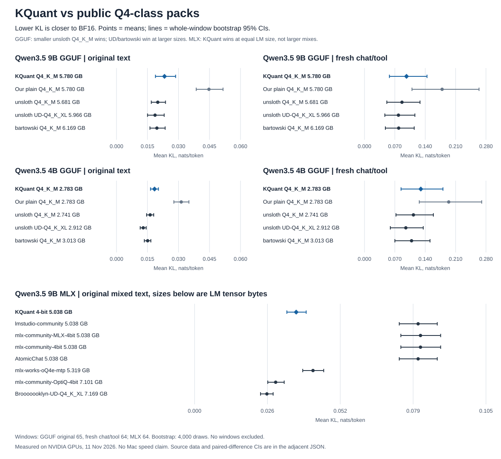

# KQuant vs public Q4-class packs

Measured 11 November 2026 for task #469. These are accuracy and BF16-closeness measurements, not inference-speed results.

## Verdicts

- **Qwen3.5-9B GGUF: worse** than the best public file at our size. Unsloth Q4_K_M is smaller and has lower KL on both corpora.
- **Qwen3.5-4B GGUF: worse** than the best public file at our size. Unsloth Q4_K_M is smaller and has lower KL on both corpora.
- **Qwen3.5-9B MLX: better** than equal-LM-size public packs. The larger UD and OptiQ mixed-bit packs have lower KL, so this is not a win over every pack called 4-bit.

KQuant improves on our uncalibrated GGUF control, but that does not establish a win over public calibrated files. The new chat/tool set gives the same ranking; the GGUF loss is not confined to the old text set.



## GGUF

KL is KL(reference || candidate), in nats per scored token. Lower is closer. Same-top is the percentage of positions where the candidate and BF16 choose the same top token. Brackets are whole-window bootstrap 95% CIs. Sizes use decimal GB and include the entire GGUF, including unused auxiliary tensors.

### 9B, original text

| File | GB | Mean KL [95% CI] | Same-top |
|---|---:|---:|---:|
| KQuant Q4_K_M | 5.780 | 0.02323 [0.01886, 0.02861] | 95.02% |
| Our plain Q4_K_M | 5.780 | 0.04474 [0.03858, 0.05157] | 92.52% |
| unsloth Q4_K_M | 5.681 | 0.01997 [0.01685, 0.02372] | 95.25% |
| unsloth UD-Q4_K_XL | 5.966 | 0.01866 [0.01503, 0.02309] | 95.49% |
| bartowski Q4_K_M | 6.169 | 0.01955 [0.01620, 0.02355] | 95.46% |

### 9B, fresh chat/tool

| File | GB | Mean KL [95% CI] | Same-top |
|---|---:|---:|---:|
| KQuant Q4_K_M | 5.780 | 0.09686 [0.05746, 0.14410] | 93.66% |
| Our plain Q4_K_M | 5.780 | 0.17892 [0.10946, 0.26403] | 90.88% |
| unsloth Q4_K_M | 5.681 | 0.08641 [0.05149, 0.12801] | 94.03% |
| unsloth UD-Q4_K_XL | 5.966 | 0.07827 [0.04688, 0.11612] | 94.39% |
| bartowski Q4_K_M | 6.169 | 0.07882 [0.04814, 0.11465] | 94.21% |

### 4B, original text

| File | GB | Mean KL [95% CI] | Same-top |
|---|---:|---:|---:|
| KQuant Q4_K_M | 2.783 | 0.01841 [0.01648, 0.02030] | 94.18% |
| Our plain Q4_K_M | 2.783 | 0.03133 [0.02776, 0.03504] | 93.19% |
| unsloth Q4_K_M | 2.741 | 0.01629 [0.01457, 0.01801] | 94.61% |
| unsloth UD-Q4_K_XL | 2.912 | 0.01294 [0.01147, 0.01438] | 95.15% |
| bartowski Q4_K_M | 3.013 | 0.01508 [0.01348, 0.01663] | 94.87% |

### 4B, fresh chat/tool

| File | GB | Mean KL [95% CI] | Same-top |
|---|---:|---:|---:|
| KQuant Q4_K_M | 2.783 | 0.12983 [0.08429, 0.18083] | 92.03% |
| Our plain Q4_K_M | 2.783 | 0.19413 [0.12632, 0.27013] | 90.31% |
| unsloth Q4_K_M | 2.741 | 0.11280 [0.07262, 0.15874] | 92.41% |
| unsloth UD-Q4_K_XL | 2.912 | 0.09527 [0.05957, 0.13544] | 93.46% |
| bartowski Q4_K_M | 3.013 | 0.10850 [0.07001, 0.15101] | 92.75% |

### Paired KL differences

Difference = public file minus KQuant, on the same positions. Negative favors the public file. These are paired intervals, not a comparison of overlapping marginal CIs.

| Comparison | Original text, difference [95% CI] | Chat/tool, difference [95% CI] |
|---|---:|---:|
| 9B unsloth Q4_K_M | -0.00325 [-0.00654, -0.00107] | -0.01045 [-0.01747, -0.00457] |
| 9B unsloth UD-Q4_K_XL | -0.00457 [-0.00687, -0.00209] | -0.01859 [-0.03006, -0.00981] |
| 9B bartowski Q4_K_M | -0.00367 [-0.00633, -0.00128] | -0.01805 [-0.03206, -0.00721] |
| 4B unsloth Q4_K_M | -0.00212 [-0.00305, -0.00127] | -0.01703 [-0.02460, -0.01049] |
| 4B unsloth UD-Q4_K_XL | -0.00547 [-0.00642, -0.00444] | -0.03456 [-0.04824, -0.02271] |
| 4B bartowski Q4_K_M | -0.00333 [-0.00417, -0.00258] | -0.02133 [-0.03073, -0.01315] |

The sign also holds in the tool and general-chat halves separately. It survives a sensitivity check that resamples nonoverlapping blocks of four adjacent context windows. Those wider paired intervals are in the JSON.

### GSM8K-100

All files answered the same 100 test problems, with temperature 0, thinking off and at most 1,024 generated tokens. Scores are correct answers out of 100. The few-answer differences do not establish an accuracy advantage.

| File | 9B | 4B |
|---|---:|---:|
| KQuant Q4_K_M | 95 | 94 |
| Our plain Q4_K_M | 93 | 95 |
| unsloth Q4_K_M | 98 | 96 |
| unsloth UD-Q4_K_XL | 97 | 93 |
| bartowski Q4_K_M | 96 | 96 |

## MLX side measurement

All eight files use the same MLX CUDA evaluator, BF16 source and token array. LM size counts non-vision, non-MTP tensor payloads; total size is all safetensors files on disk. This distinction matters because some packs omit vision and the mixed-bit packs are much larger. Equal label names do not mean equal bit budgets.

| Pack | LM / total GB | Mean KL [95% CI] | GSM8K-100 |
|---|---:|---:|---:|
| kquant | 5.038 / 5.950 | 0.03662 [0.03327, 0.04022] | 96 |
| lmstudio-community | 5.038 / 5.950 | 0.08055 [0.07376, 0.08746] | 96 |
| mlx-community-MLX-4bit | 5.038 / 5.950 | 0.08141 [0.07433, 0.08867] | 95 |
| mlx-community-4bit | 5.038 / 5.950 | 0.08141 [0.07433, 0.08867] | 95 |
| AtomicChat | 5.038 / 5.038 | 0.08055 [0.07376, 0.08746] | 96 |
| mlx-works-oQ4e-mtp | 5.319 / 6.231 | 0.04267 [0.03898, 0.04653] | 95 |
| mlx-community-OptiQ-4bit | 7.101 / 8.013 | 0.02922 [0.02638, 0.03230] | 96 |
| Brooooooklyn-UD-Q4_K_XL | 7.169 / 8.081 | 0.02606 [0.02377, 0.02832] | 95 |

KQuant has 54.5% lower KL than lmstudio-community at equal LM size. Both score 96/100 on GSM8K. The lower-KL OptiQ and UD files carry 40.9% and 42.3% more LM tensor bytes, respectively.

### MLX same-top agreement

| Pack | Same-top | Paired KL difference vs KQuant [95% CI] |
|---|---:|---:|
| kquant | 92.41% | reference row |
| lmstudio-community | 88.51% | +0.04394 [+0.03941, +0.04856] |
| mlx-community-MLX-4bit | 88.42% | +0.04479 [+0.04013, +0.04960] |
| mlx-community-4bit | 88.42% | +0.04479 [+0.04013, +0.04960] |
| AtomicChat | 88.51% | +0.04394 [+0.03941, +0.04856] |
| mlx-works-oQ4e-mtp | 91.03% | +0.00606 [+0.00465, +0.00751] |
| mlx-community-OptiQ-4bit | 93.39% | -0.00740 [-0.00954, -0.00533] |
| Brooooooklyn-UD-Q4_K_XL | 93.56% | -0.01056 [-0.01306, -0.00839] |

The two mlx-community standard packs have identical metric arrays, and AtomicChat matches lmstudio-community on these measurements. They remain separate requested files, not independent replications. No separate unsloth-owned MLX 9B pack was found in the public search; the Brooooooklyn UD conversion is included instead and is not labeled as an unsloth publication.

## Method

- **Runs:** NVIDIA L40S candidate evaluation; H100 BF16 chat-reference preparation. GGUF uses llama.cpp commit `0a94a3f289687883617b9a2abbc7e0ade2d6b6c4`. MLX uses CUDA, version 0.32.4, with mlx-lm 0.32.2. Neither table is a Kapitsa-engine or Apple-Metal benchmark.
- **Kapitsa version:** results branch started at `b860872f3b5b52b11e77f5ae2e3c8834e383be7b`. No Kapitsa runtime changed. These measurements did not come from `kapitsa bench` and are not community benchmark submissions.
- **Flags:** GGUF `llama-perplexity -ngl 99 --kl-divergence-base REF --kl-divergence`, with `-c 512 -b 512` for old text and `-c 1024 -b 1024` for fresh chat/tool text. BF16 and candidates consume the exact token IDs in the KL reference file. A patch records per-position KL and same-top flags before llama.cpp sorts KL values.
- **Old GGUF text:** the existing k436 stream from wikitext-2 test, GSM8K-train chats and HumanEval. 65 windows of 512 input tokens, each starting from reset model state; llama.cpp scores 255 positions per window, 16,575 in total. The exact input-token SHA256 is in the JSON. The shared GGUF reference header confirms both models used the same token IDs.
- **Fresh GGUF chat/tool text:** seed 469, NousResearch/hermes-function-calling-v1 `func-calling.json` and HuggingFaceH4/no_robots train. We rendered 15 tool and 99 general-chat conversations with the BF16 model chat template, then took 32,768 tokens from each stream and alternated four 1,024-token windows per source. Total 64 windows, 65,536 inputs, 32,704 scored positions. This is a second test distribution. Calibration-corpus membership was not audited for any pack.
- **MLX text:** the existing 64-by-512 k436 token array, with 40 wikitext-2, 12 GSM8K-train-chat and 12 HumanEval windows. MLX scores 511 next-token positions per window, 32,704 total. It evaluates all positions, unlike llama.cpp's second-half scoring. Absolute KL and GSM8K values must not be compared across the two engines as a controlled format A/B.
- **Uncertainty:** 4,000 paired whole-context-window bootstrap draws, NumPy `default_rng(469)`, percentile 2.5/97.5 intervals. The same draw indices apply to every file in a table. A four-window-block sensitivity check keeps the final short block. Windows reset model state but adjacent windows and windows from the same conversation can remain correlated. These intervals describe this fixed test collection, not all chat or tool-use tasks; they are not adjusted for multiple comparisons.
- **Identity:** the JSON records BF16 GGUF file hashes, source-token hashes, MLX source-cache revision and tokenizer hashes, and every candidate repo revision. Evaluated KQuant staging revisions match the released GGUF blobs by LFS SHA256. The plain GGUF control is our uncalibrated Q4_K_M of the same BF16 reference.
- **Accuracy:** zero-shot GSM8K-100, final-number match with absolute tolerance below 1e-6. Full per-item IDs, gold answers, predictions and correctness are in the JSON. Prompt formatting and generation code are fixed within each engine, not across engines.

## Limits

No Mac speed, memory-residency or Kapitsa-output test ran. The tool corpus measures next-token closeness, not tool-execution success. GSM8K supplies the independent task-accuracy check, not a tool-calling score. There is no BF16 GSM8K accuracy row in this run. The public label Q4_K_M does not fix tensor mixes, auxiliary tensors or total bytes, so the size column is part of the comparison.

## Data and replay

- [kquant-public-h2h-20261111.json](<kquant-public-h2h-20261111.json>): all means and CIs, exact sizes and repo revisions, per-window sums, per-item GSM8K rows and input/reference identities.
- [verify_kquant_public_h2h_20261111.py](<verify_kquant_public_h2h_20261111.py>): recompute every reported mean, interval and paired difference from the saved window sums; validate all 1,800 accuracy items. Needs NumPy, no GPU or model.

```bash
uv run --with numpy python bench/results/verify_kquant_public_h2h_20261111.py
```

The original per-token dumps and native evaluator logs remain in Modal volume `k409-quant`, environment `naceDM-test`, under `/h2h/`; BF16 references remain under `/gguf/`. The JSON stores the window sums needed to repeat the statistical analysis without downloading logits or weights.
