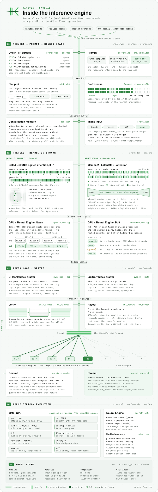

# Engine architecture

Kapitsa is a native C++20 inference engine for Apple silicon. Its HTTP APIs share one chat engine; model-specific
backends encode work into Metal command buffers and can offload selected prefill operations to Apple's Neural Engine.
It does not use the MLX or llama.cpp runtime. Compatible checkpoint formats do not imply a runtime dependency.

<picture>
  <source media="(prefers-color-scheme: dark)" srcset="assets/architecture-dark.svg">
  
</picture>

The generation loop repeats until completion, streaming through the API adapter. Image encoders run only for
supported image requests, and Neural Engine work is limited to selected prefill operations. Conversation slots retain
state for later turns; requests sent at once take turns on the GPU for their prompts and share batched passes while
they decode.

## From a request to generated tokens

1. **Normalize the API request.** The server exposes OpenAI Chat Completions, OpenAI Responses and Anthropic
   Messages. Adapters translate these into `ChatRequest`; output adapters return each protocol's streaming events,
   reasoning and tool calls. The built-in chat page uses the same server.
2. **Build the prompt and recover conversation state.** The engine renders the model's Jinja chat template,
   tokenizes the prompt, chooses a conversation slot and reuses a matching prefix. A slot holds attention KV caches,
   recurrent state and checkpoints. Only the uncached suffix needs prefill when a compatible checkpoint exists.
3. **Prefill the target model.** The selected backend processes prompt chunks, using its own attention, recurrent
   and feed-forward kernels. Models with a vision tower can insert image embeddings into those prompt rows. On the
   Qwen models a pass of at most 128 rows (a cached turn's message, the reply prefilled while idle, a draft read
   ahead) gives each row the same bits whatever the pass's length (`NI_SHORTPF_EXACT`), so splitting a short tail
   into passes changes no logit; longer passes run the large-prefill kernels, whose sums are ordered otherwise.
4. **Draft and verify.** Qwen uses its block drafter when available (DFlash2 on the 35B and 27B, DFlash on the 4B),
   otherwise its MTP head where supported. Nemotron uses a block drafter: LiLiCorr (Bolt, Super-VL) or DSpark
   (Lightning). The target verifies proposed tokens; accepted tokens advance the sequence, and rejected proposals do
   not become committed recurrent history. KFlash (every drafter by default; `NI_KFLASH=0` keeps chains, and
   `NI_DFLASH_CAP=<n>` opts the Qwen DFlash2 drafters into the F74 capped-depth chains — an opt-in cap that keeps
   chains (the trees need the full depth) whose two clean depth-2/3 mode-3 anchors read cheaper per token than any
   deeper measured arm, ids-identical, with the shipping-binary sweep to
   decide whether it becomes their default): the
   drafter's candidates are verified as a best-first tree instead of one chain: each verify row attends to its
   ancestors only, the recurrent layers run from its own branch's state, and the longest branch that agrees with the
   target is kept, so the reply is plain decoding's. The tree's size follows this Mac's measured cost per verify row
   count and the drafter's probabilities as calibrated against its own acceptances: whole 8-row tiles on the dense Qwen
   models (27B, 4B), where each cycle verifies 8 rows, or 16 or 32 when `NI_KFLASH_ROWS=8,16,32` names them (opt-in, but
   for the 16-row drafting block below, which sets every cycle to 16 rows on a one-slot engine; the GPU runs the tiles the
   drafting pass chose, with
   no host round trip), as many as pay in expected tokens per millisecond on this Mac; on MoE targets (the Qwen
   35B-A3B, the Nemotron drafters), whose verify pays per row for its experts, 1 to 8 rows per pass, the GPU routing
   experts (and running the recurrent step and the sampler) for those rows alone. Plain generation is available with
   `--spec 0`.
5. **Stream and retain state.** The output parser separates content, reasoning and complete tool calls. The engine
   retains the slot for follow-ups and can prefill the rendered assistant history while idle. While the user types
   the next message, `POST /v1/draft` reads the draft ahead the same way (`Engine::draft`): a checkpoint at the user
   turn's start, then the live state extended with the draft up to its last whitespace, so the request, once sent,
   continues that state and prefills only what was typed since (an edited draft restores the checkpoint).

Requests sent at once each run on a slot of their own and take turns on the GPU (a first-come-first-served turn lock):
between prefill chunks, and between decode cycles once a request has held the GPU for 30 ms. Before it gives its turn
away a request parks: nothing of its own left in flight and nothing it needs next left in the model's or the drafter's
shared buffers, so a request that only takes turns runs the cycles, and gets the tokens, it would alone. `--slots` (up
to 4 by default, as memory allows) sets how many run at once; with every slot busy a request waits for one. Image
fetching, the chat template and the tokenizer run before a request takes its turn.

When two or more requests decode at once with a block drafter (DFlash2 on the Qwen 27B and 35B-A3B, LiLiCorr on Bolt),
their decode cycles are batched. At a cycle boundary a parked request joins the batch, and one member's thread holds the
turn and runs every member's cycles (`Engine::run_batch`): each member's draft when it verifies drafts, then one target
pass over all the members' rows (`encode_verify_multi`, up to 8 rows). The norms, projections, MLP or experts and the LM
head run once over every row, so each weight is read once for all the members; each member's recurrent scan, convolution
window and attention over its own KV cache run side by side in the same command buffer. Every member keeps its own
drafter ring, acceptance (the longest greedy match, or the exact speculative sampling of a sampled DFlash2 request),
parser and stream. With DFlash2, KFlash's batch budget (`KfBatch`) decides the rows every cycle, once the members'
drafting passes are done: a member's draft is worth the calibrated chance that the target accepts it and the drafts
before it (the drafter's probabilities calibrated against the verify's own acceptances, as for KFlash trees; a sampled
request's against its speculative sampling's), every member verifies its anchor, and the drafts go in decreasing worth
over the whole batch, each while it pays for one more row at this Mac's measured cost (a batched cycle's GPU time by
members and rows) and the batch's recent tokens per ms, up to the pass's 8 rows. A draft's place never depends on the
draft itself, so a sampled request's speculative sampling stays exact. The rows are chosen on the host (the verify's
per-member dispatches take their rows when encoded), so the verify is encoded once the drafting passes are done; its
first layer goes to the GPU at once. With LiLiCorr the rows follow a table, as measured (`Engine::batch_rows`): two
requests verify 3 drafts each, three 1 draft each and four plain rows (`NI_BATCH_KF=0` gives DFlash2 its table too:
two requests 3 drafts each, three or four 1 draft each, the 27B's three taking turns). The Qwen3.5 4B's DFlash
drafter, Nemotron 3.5 Lightning and Super-VL take turns until measured
(`NI_BATCH=1` batches them too). A member that finishes leaves the batch, and the last one goes back to its own loop.
One request alone runs the single-stream path unchanged. Requests decoded together can get other tokens than alone where
two candidates are within the batched pass's rounding of each other, and sampled requests draw other random numbers;
`NI_BATCH=0` makes them take turns instead.

## Four model backends

| | Qwen3.5 family | Nemotron 3.5 Bolt | Nemotron Dory | Recursive Flint |
| --- | --- | --- | --- | --- |
| Backend | `Qwen35` | `NemotronH` | `Dory` | `Flint` |
| Recurrent layers | Gated DeltaNet | Mamba-2 | None: a shared block of 40 sublayers runs 1-4 times per token (looped) | None |
| Other layers | Attention; dense FFN or MoE | Attention; LatentMoE (dense relu² MLP in Nemotron Nano 4B / 9B v2) | Sliding-window and full attention, dense MLP; normalized (nGPT) residuals | Sliding-window and full attention with learned sinks; MoE (2 dense layers first) |
| Default speculation | DFlash2 on 35B/27B; DFlash on 4B | LiLiCorr block drafter (DSpark on Lightning); prompt lookup on Nemotron Nano 4B | None with last-loop KV; prompt lookup with per-loop KV | None (prompt lookup with `--spec`) |
| Checkpoints | MLX-format safetensors; supported GGUF imports | NVIDIA's safetensors checkpoint | NVIDIA's safetensors checkpoints | Recursive's MLX export; GGUF imports (unsloth's UD-IQ files) |
| Weight formats | BF16 and supported affine quantizations | NVFP4, IQ2_XXS, Q8_0 and BF16 by tensor type | NVFP4 or BF16 (on the Nemotron-H kernels; the LM head 8-bit with NVFP4) | Affine 4-bit, 8-bit embedding, BF16 router; a GGUF import's routed experts in their IQ blocks |
| Neural Engine prefill | Dense FFN portions | Mamba projections and shared-expert work | None | None |

Qwen3.8-Flash-Next (`Qwen4Exp`) is a subclass of `Qwen35` that reuses its projections, DeltaNet, attention, experts,
sampler and KV handling, and adds the 4-stream hyper-connection residual, the per-layer n-gram embedding (hashed and
gathered on the CPU from a mapped table) and the sparse-attention indexer. A pack with Q2_0 routed experts
([`moe_q20.h`](../src/model/moe_q20.h)) can keep only part of them in memory: an expert store
([`expert_store.h`](../src/model/expert_store.h)) holds them in slots the expert kernels read through a slot table,
and a handshake between each layer's routing and its expert kernels lets a CPU thread read the missing ones from the
SSD before the GPU goes on.

Recursive's Flint (`Flint`) has no recurrent layers: 35 sliding-window attention layers keep their keys in a ring of
528 positions per conversation (the window of 513 and 8 spare rows that a verify pass may fill), 14 full-attention
layers keep a growing cache, and each head's learned sink joins its softmax. A decode row's attention is one dispatch
(`flint_attn_d2`: norms, RoPE, the cache write, split-K over 32-key tiles, the merge by the last threadgroup); verify
passes and prefill chunks use split-K and tiled kernels of their own. Its MoE routes by sigmoid scores with an
always-on shared expert, on the base library's expert kernels (`moe_gate_up3`, `moe_down`, the 2-4-row `moe4_*`, the
prefill's grouped GEMMs). Its activations pass half's range in places (up to 75776 at layer 46), so the prefill's
SwiGLU stores such rows divided by a power of two and folds the factor back into the row's weight
(`flint_swiglu_scaled`). It has its own pre-tokenizer split and GLM's tool-call format in the output parser.

Flint's backend also runs a dense Llama (`model_type` `llama`, Nanbeige4.3-33B) as a Flint without its extras: every
layer full attention with RoPE and a dense SwiGLU MLP, no q / k norms (`flint_prep_nonorm`) and no sinks (a sink of
-inf, which leaves each softmax as it is without one, exactly). Its 7 query heads per KV head take 7-head forms of
`flint_attn_d2` and `qattn_t_flint` (written for 8: each token's eighth fragment row is a spare head whose results are
dropped); bf16 weights run on `wfmt.metal`'s kernels. Its tokenizer is SentencePiece-style BPE (`src/tokenizer`: Metaspace and byte
fallback) and its chat markup Qwen's (`<think>`, XML tool calls).

All four implement `Model`: memory planning, sequence allocation, KV growth, recurrent checkpoints, prefill and decode.
Speculative paths remain specialized: the engine also holds backend-specific pointers and drafter state. Adding a
new architecture requires more than implementing `Model` if it needs a new drafter, tokenizer behavior or vision tower.

## Where the speed comes from

* **Shape-specific Metal kernels.** Quantized matrix operations, fused projections, attention, recurrent scans and
  grouped expert operations avoid routing all work through general-purpose tensor operators. The Qwen and Nemotron
  backends have separate kernel sets for their shapes and stored weight formats.
* **QMT prefill.** On Apple10 GPUs (the M5) under macOS 26, the 4-bit dense GEMMs of the Qwen3.5
  backend and its prefill attention for head dim 256 with 4 query heads per KV head (the 4B and 9B, `qattn_t_g4d2s8`: the same pair kernel over (token, head) rows;
  `NI_QATTN_G4D2=0` keeps `qattn_t_s8k16`) and 8 (the 35B, on
  `qattn_t_g8d2s8` by default, which splits the head dim over a pair of simdgroups; `NI_QATTN_D2=0` runs `qattn_t_g8s4k16`) and 6 (the 27B, `qattn_t_g6d2s8`: the same pair kernel over (token, head) rows; `NI_QATTN_G6=0` keeps `attn_prefill11r`) run on Metal 4 tensor ops (`src/kernels/tensor/qmt.metal`, `qattn_t.metal`; `NI_QMT=0` turns it off, `NI_QATTN_G8=0` keeps the 35B on `attn_prefill11r`).
  The 6-bit group-64 dense weights of those packs run their prefill GEMMs from 64 rows up on a tile of the same kind
  (`src/kernels/tensor/qmt6.metal`: `qmt6_m64_n64`, `qmt.metal`'s 64x64x32 double-buffered `matmul2d`, one 32-K one per
  step where the simdgroup path runs four 8-K MMAs) whose weight decode is `qrf`'s half-domain one, bitwise, so only the
  K reduction's order differs; `NI_QMT6=0` keeps `qrf_f6g64_m32_n128`, and below 64 rows the older paths run anyway.
  The 35B-A3B's routed expert prefill runs the same tile over the MoE bucket's 64-row expert tiles
  (`src/kernels/tensor/qmt_moe.metal`, `NI_MOE_QTM=0` keeps it on the simdgroup kernels), and so do Flint's routed
  expert GEMMs (`qmtm_g_m64_n64`: gate, up and down each to fp32 rows, so `flint_swiglu_scaled` still sees whole rows;
  `NI_FLINT_MOE_QTM=0` keeps `qmm_moe_b4_m16_n64`; these tiles write whole output rows staged through threadgroup
  memory, `NI_MOE_STAGE=0` keeps one store per accumulator element), Qwen3.8-Flash-Next's Q2_0 routed expert prefill
  (`src/kernels/tensor/qmt_moe_q20.metal`: the same 64-row tile on the Q2_0 weight rows, the qrm kernels' per-element
  arithmetic kept — the decode is exact and the products accumulate in fp32 — so only the tiling reassociates the K
  reduction; `NI_MOE_QTM_Q20=0` keeps the simdgroup kernels), and Flint's prefill attention (head dim 128, 8 query heads per
  KV head: `tensor/qattn_t_flint.metal`, `NI_FLINT_QATTN=0` keeps `flint_attn_prefill`). Measured on the 4B (dense),
  the 35B-A3B and Flash-Next (experts): none is bit-identical to the simdgroup paths, since the tile reassociates each output's
  K reduction, so the experts' tile is gated by `tools/logit_compare.py --reorder` (AGENTS.md) rather than the model's
  noise floor.
* **Several verified tokens per target pass.** DFlash2, MTP and LiLiCorr amortize target-model work when the drafts
  are accepted. Throughput depends on the model, prompt, sampling settings and acceptance rate.
* **Requests at once share passes.** While several requests decode, one target pass verifies all of their rows and
  reads each weight once for all of them. The KFlash budget
  (`src/model/kflash_budget.*`) picks how many rows each request gets, every cycle.
* **Prefix reuse.** KV caches and recurrent-state checkpoints avoid rereading an entire conversation for each turn.
  Image embeddings have their own content-aware cache, so a changed image cannot reuse another image's prompt state.
  The SSD prefix cache (`src/engine/prefix_cache.h`, `engine_disk.cpp`) keeps those states as files too, so evicted
  conversations and server restarts keep them: KV rows in blocks keyed by the tokens and the requests that computed
  them (a conversation's turns share their blocks), states byte for byte as the slot held them, CRC-checked.
* **GPU and Neural Engine overlap.** Eligible prefill operations split across both processors. GPU work and Neural
  Engine jobs synchronize through shared events. The split uses additional quantization and is a numerical tradeoff;
  it is distinct from speculative verification. Runtime checks and watchdogs can disable the split and rerun a
  failed chunk on the GPU.

These are implementation mechanisms, not guarantees of a fixed speedup. Measured results and their conditions live
in the [benchmark reports](benchmarks.md).

## Loading, images and memory

The model catalog pins checkpoint and companion revisions. Downloads resume and validate checksums. The safetensors
loader supplies weights to the backends; Bolt repacks codes and scales into its GPU layout at load time. Supported
Qwen GGUF files are converted once into a reusable model folder.

Vision is optional. `open_encoder` selects `QwenViT` for supported Qwen checkpoints (the 4B's tower: 24 blocks, head
dimension 64; the 35B's and 27B's: 27 blocks, head dimension 72) or `RadioViT` for Nemotron 3.5 Bolt's and Super-VL's
C-RADIO ViT-H/16 tower and projector (Super-VL layer-normalizes the tower's output first). The tower loads on the
first image request; CPU image preparation and cached GPU embeddings feed the model's prefill. Qwen uses M-RoPE
positions; Bolt and Super-VL wrap image rows in their image tokens and use attention without positional embeddings.
The text benchmarks do not measure images.

Memory planning happens before weights load. Per-slot KV caches grow within a budget derived from Metal's recommended
working set or `--mem-budget`. Under pressure, the engine can release cached image data, idle slots' KV caches and
Neural Engine resources. `kapitsa doctor` uses the same planning logic to report what fits.

## Source map

| Component | Entry points |
| --- | --- |
| CLI, HTTP routes and chat page | [`src/server/`](../src/server/) |
| OpenAI Responses and Anthropic adapters | [`src/api/`](../src/api/) |
| Request lifecycle, slots, turns, batched decoding and generation | [`src/engine/engine.cpp`](../src/engine/engine.cpp) |
| Shared model contract and sequence state | [`src/model/model.h`](../src/model/model.h) |
| Qwen backend and drafters | [`qwen35.h`](../src/model/qwen35.h), [`dflash2.h`](../src/model/dflash2.h); KFlash's budgets (trees, batched rows): [`kflash_budget.h`](../src/model/kflash_budget.h) |
| Qwen3.8-Flash-Next | [`qwen4_exp.h`](../src/model/qwen4_exp.h), [`ngram.h`](../src/model/ngram.h), [`qwen4.metal`](../src/kernels/qwen4.metal); Q2_0 experts and their store: [`moe_q20.h`](../src/model/moe_q20.h), [`expert_store.h`](../src/model/expert_store.h), [`zq2moe.metal`](../src/kernels/zq2moe.metal) |
| Nemotron backend and drafters | [`nemotron_h.h`](../src/model/nemotron_h.h), [`nh_drafter.h`](../src/model/nh_drafter.h), [`lilicorr.h`](../src/model/lilicorr.h), [`dspark.h`](../src/model/dspark.h); KFlash trees: [`kflash_budget.h`](../src/model/kflash_budget.h), [`nh_tree.metal`](../src/kernels/nemotron/nh_tree.metal) |
| Dory backend (looped; loops and KV mode per request and server) | [`dory.h`](../src/model/dory.h), [`src/kernels/dory/`](../src/kernels/dory/) |
| Flint backend (and dense Llama models: Nanbeige4.3) | [`flint.h`](../src/model/flint.h), [`src/kernels/flint/`](../src/kernels/flint/); the timing tools [`flint_bench.cpp`](../tools/flint_bench.cpp) and [`flint_kbench.cpp`](../tools/flint_kbench.cpp) |
| Metal runtime and kernels | [`src/metal/`](../src/metal/), [`src/kernels/`](../src/kernels/) |
| Neural Engine bridge and splits | [`src/ane/`](../src/ane/), [`nemotron_ane.h`](../src/model/nemotron_ane.h) |
| Image encoders and embedding cache | [`src/vision/`](../src/vision/) |
| Catalog, downloads and weights | [`src/hub/`](../src/hub/), [`src/loader/`](../src/loader/) |
| `kapitsa bench`: the harness's protocol, this Mac's conditions, the result and its submission | [`src/bench/`](../src/bench/), [`bench_cmd.cpp`](../src/server/bench_cmd.cpp) |
| `kapitsa update` and the automatic update | [`src/update/`](../src/update/), [`update_cmd.cpp`](../src/server/update_cmd.cpp) |

The Neural Engine bridge uses Apple's private framework interfaces. See [third-party notices](../THIRD_PARTY_NOTICES)
for adapted code and design credits, the [usage guide](usage.md) for options and switches, and
[CONTRIBUTING.md](../CONTRIBUTING.md) for building and testing.

## Updating the diagram

The diagram is hand-written SVG in two variants, [architecture-dark.svg](assets/architecture-dark.svg) and
[architecture-light.svg](assets/architecture-light.svg), with no fonts or scripts, so GitHub shows it as drawn. Edit
both and preview them at README width (about 830 px) in dark and light mode. The logo and the README header are in
[assets/brand](assets/brand/README.md) and [header-dark.svg](assets/header-dark.svg).
