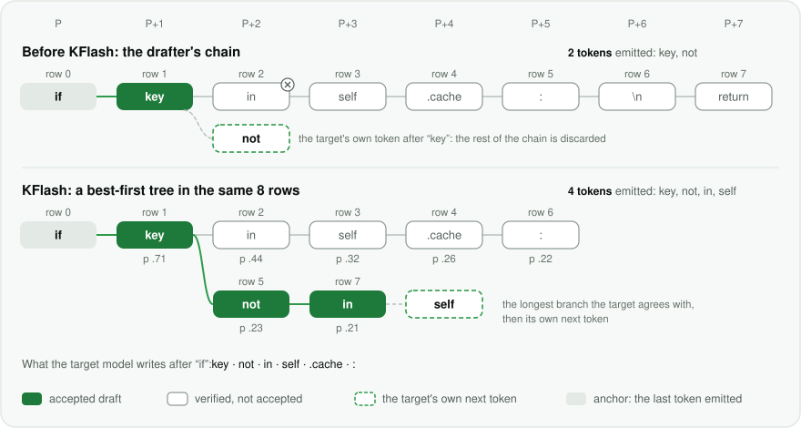
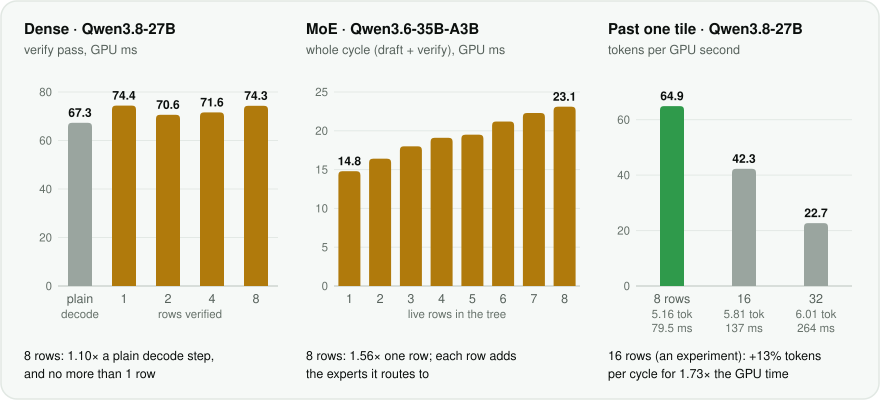
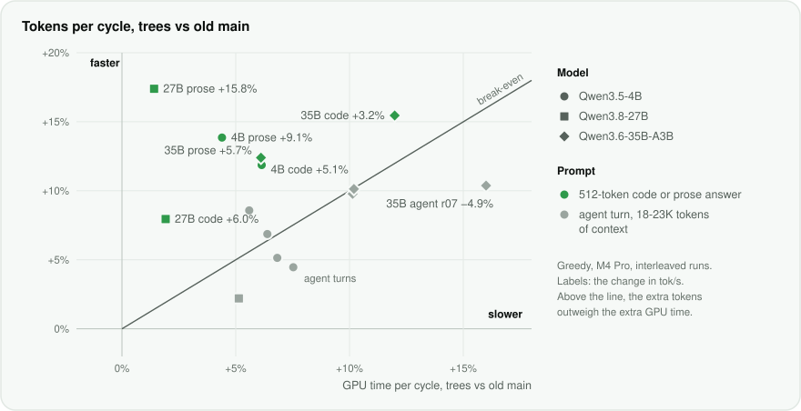

# KFlash: verifying the drafter's best guesses as a tree

**In short:** a speculative decoder guesses several tokens and lets the big model check them, but engines that run a drafter as published check one chain and stop at its first wrong guess. KFlash checks a best-first tree of the drafter's candidates in the same 8-row pass, and keeps only tokens the big model itself writes, so on the Qwen dense models a greedy reply is the one plain decoding writes (the 35B can part from it at near-ties, as the chain did). On an M4 Pro against the engine just before it, the 27B's greedy decoding was 6.0% faster over three prompts (code +6%, prose +16%, a long agent turn −3%), and with three requests at once the 27B gained 15-23%.

Kapitsa writes several tokens per pass of the big model. A small block drafter guesses the next 7 tokens, and the
target model checks all of them in one pass of 8 rows: the last token it wrote, plus the 7 guesses. It keeps the guesses
it agrees with, up to the first one it doesn't, and adds one token of its own. When the guesses are right, one pass
writes up to 8 tokens.

The drafter knows more than 7 tokens, though. At every position it ranks a short list of candidates (16 on DFlash and
DFlash2), and when its first choice is wrong, the token the target wanted is often still on the list. Before KFlash,
Kapitsa verified one chain per cycle: the drafter's own path through its candidates. The first wrong guess ended the
cycle, and the rows after it were wasted.

KFlash verifies the drafter's best guesses as a tree. It builds a best-first tree from the candidates, checks the whole
tree in the same 8-row pass, and keeps the longest branch the target agrees with. The tokens it emits are always the
target's own, so a greedy reply is the one plain decoding writes, and a sampled reply the one plain sampling writes with
the same seed. The tree's size comes from a budget that each Mac measures for itself.

On a MacBook Pro with an M4 Pro, against the engine just before it, KFlash made greedy decoding of a coding answer 6%
faster on Qwen3.8-27B, 5% on Qwen3.5-4B and 3% on Qwen3.6-35B-A3B; on a prose answer, 16%, 9% and 6%. Long agent turns,
where the chain already does well, landed between −5% and +3%. KFlash has been on by default since
[#187](https://github.com/nace-ai/kapitsa/pull/187); `NI_KFLASH=0` brings the chain back.

## The chain stops at the first miss

Past its first miss, a chain is worth nothing. Take a coding answer that has reached `if` and goes on
`key not in self.cache:`. The drafter's first choice after `key` is `in`, with `not` a close second. The chain verifies
`if key in self.cache: \n return`. The target accepts `key`, writes `not` where the chain has `in`, and the cycle
ends: 2 tokens for 8 rows of work. The drafter had `not` all along.

<picture>
  <source media="(prefers-color-scheme: dark)" srcset="assets/kflash-cycle-dark.svg">
  
</picture>

**Figure 1.** One cycle, two ways to spend the same 8 rows (an illustration). Top: the drafter's chain. The target
accepts `key`, then writes `not`, and the rest of the chain is discarded. Bottom: a best-first tree of the same
candidates. Rows are numbered in the order the builder takes them, with each node's path probability. The target
accepts `key`, `not` and `in`, then writes `self`. Positions count from P, the last token written.

The right token is often on the list because a block drafter predicts all 7 positions at once and ranks candidates
for each, without knowing which of its earlier guesses the target will take. DFlash2 adds a path selector, pairwise
scores between neighboring candidates, so that its chain hangs together. A tree uses the same scores differently: it
keeps the runner-up alive where the drafter is unsure, and goes deep where it is sure.

## A tree in the rows the chain already pays for

The tree costs little extra because of how Apple's GPUs do matrix math. They multiply matrices in 8×8 tiles, and
Kapitsa's verify pass is built around them: its matrix kernels run the pass's rows as one 8-row tile. On a dense model
such as Qwen3.8-27B, the pass reads each weight once, as a one-row decode step does. It costs about 1.1-1.25× that step,
and about the same with 1 row as with 8 (Figure 2, left). The chain was already paying for 8 rows. KFlash changes what
goes in them. What a tree cycle does cost extra on the dense models, 1-6% at short context, is the tree's own work:
building it, its attention, its branch states and moving the accepted rows into place.

Mixture-of-experts models are different. Each row picks its own 8 of the 35B's 256 experts, and extra rows bring in
experts the others didn't pick. A 35B cycle costs 14.8 ms with 1 row and 23.1 ms with 8: 1.56× (Figure 2, middle).
There a row has to earn its cost, so on the 35B and the Nemotron models the budget sizes each cycle's tree from 1 to 8
rows, and the verify routes experts only for the rows in use.

<picture>
  <source media="(prefers-color-scheme: dark)" srcset="assets/kflash-rows-dark.svg">
  
</picture>

**Figure 2.** What a verify row costs on an M4 Pro. Left: the 27B's verify pass next to a plain one-row decode step (GPU
time from `tools/batch_cost` on an earlier build, after an 85-token prompt). Middle: the 35B's whole cycle, drafting and
verify, with 1 to 8 live rows, from the budget's measured cost table. Right: 16- and 32-row tree verifies on the 27B's
coding answer, an experiment that is not in the release: 5.16, 5.81 and 6.01 tokens per cycle for 79.5, 137 and 264 ms
per cycle.

## How it works

### Building the tree

The drafter's candidates form a lattice: 7 positions, a short list of candidates at each, and for every candidate a
probability given the candidate before it. On DFlash2 that conditional comes from its path selector. z-lab's DFlash has
no selector, so its positions are independent. On Nemotron, DSpark's Markov head and LiLiCorr's transition scores play
the same part. KFlash only reads these tables, so it runs on the drafters as they are published.

The builder grows the tree best first. A node's score is the probability that the target accepts its whole path: the
product, along the path, of each node's drafter probability mapped through a calibration (see
[Sizing the tree](#sizing-the-tree-on-each-mac)). The builder takes the frontier node with the highest score, adds its
children to the frontier, and repeats until it has 8 rows: the anchor and 7 nodes. A child never scores above its
parent, so parents come before children, and the first n rows are the best n-row tree for every n. The size can then be
chosen after the tree is built. The builder is one 32-thread GPU kernel at the end of the drafting pass, so building a
tree never waits on the CPU.

### Verifying it in one pass

Each row's token sits at the position its depth gives it: row 5 in Figure 1 is `not` at P+2, beside row 2's `in`.
Inside the pass, three things keep the branches apart:

- **Attention.** A row reads the cached history and, among the pass's rows, only its ancestors and itself.
- **Recurrent layers.** The Gated DeltaNet layers of Qwen3.5, 3.6 and 3.8 and the Mamba-2 layers of Nemotron-H carry a
  state from token to token. Each row runs from its parent's state, not from the row above it. The Mamba-2 scan keeps
  all 8 rows' states in registers. Gated DeltaNet's state is larger, so a row whose parent is not the row above
  rebuilds its parent's state from the committed one by replaying its ancestors' updates. The short convolutions in
  front of both read each row's ancestors as well.
- **Positions.** On Qwen the rotary embeddings use the row's depth, and on every model so does the sampler's random
  number (below).

So each row's output is what plain decoding of its path would give.

<picture>
  <source media="(prefers-color-scheme: dark)" srcset="assets/kflash-pass-dark.svg">
  
</picture>

**Figure 3.** The tree of Figure 1 as the verify pass sees it. A row's position is P plus its depth. Its attention reads
the cached history and its own ancestors, and its recurrent layers start from its parent row's state. After the pass,
the accepted path's rows move into place and the others are dropped.

### Keeping the longest branch the target agrees with

The target produces its own next token after every row. Greedy, that is its argmax. At temperature > 0, it is the
plain sampler's draw, made with the random number plain decoding uses at that position. Acceptance starts at the root
and steps into the child whose token equals the current row's target token, for as long as there is one. The tokens
that come out are the target's own at every position, so they are plain decoding's, whatever the tree held. The tree
only decides how many come out of this pass. (A multi-row pass rounds a little differently from a one-row step. On the
dense models that changed no reply in our tests; on the 35B's experts it can tip a near-tie, as it already did for the
chain. See [Results](#results).)

Then the accepted path's K/V rows move into consecutive positions, and its recurrent updates fold into the committed
state at the start of the next pass. The other rows are dropped: nothing from a rejected branch becomes history. The
acceptance also writes records for the budget: every node whose parent was accepted, and whether the target took it.

## Sizing the tree on each Mac

Every cycle, the budget decides how many of the 8 rows to verify. For each row count n it needs two numbers: the tokens
a verify of n rows is expected to emit, and what that cycle costs.

**Expected tokens.** E(n) is 1, the target's own token, plus the acceptance probabilities of the first n − 1 nodes'
paths. Those probabilities come from calibrating the drafter, because its probabilities are not acceptance rates. For
each position d after the anchor, the budget fits p = σ(αd + βd · logit q). That is a logistic
regression of whether the target took a node on the drafter's probability q, over the nodes the target actually tested
(those whose parent it accepted). It refits every 16 cycles on the last 2,048 records per position, starting from
p = q. On this M4 Pro the fits show z-lab's DFlash on the 4B close to calibrated, and the DFlash2 drafters
overconfident, more so further from the anchor. On the 35B, a candidate the drafter gives 0.7 is accepted 55% of the
time at position 1 and 38% at position 4 (Figure 4, left).

**Cost.** Each cycle reports its GPU time, the drafting pass plus the verify, and the budget keeps a running table: a
base that moves with the context's length (a 35B cycle costs about 7 ms more at 21K tokens than at 100), plus an offset
for each row count. The first cycles try every allowed count three times, unless a cached table already exists.

**The choice.** The budget picks the size with the most expected tokens per millisecond. In practice it takes the n
with the largest E(n) − r · cost(n), where r is the tokens per millisecond of the recent cycles: a row goes in when its
expected tokens beat what its milliseconds would earn at the going rate. Its first 16 cycles, before r exists, use
E(n) / cost(n). Which counts it may choose depends on the target. Dense models verify whole 8-row tiles; where
`NI_KFLASH_ROWS` names 16 and 32 as well, a dense model's budget measures those tiles on this Mac and may pick them per
cycle (below), and a 16-row drafting block asks for 16 rows every cycle, so it is the block, not the budget, that
decides the count there; it also drops 32, since a block that drafts 15 guesses has nothing wider to verify. MoE targets
may choose any count from 1 to 8.

<picture>
  <source media="(prefers-color-scheme: dark)" srcset="assets/kflash-budget-dark.svg">
  
</picture>

**Figure 4.** The budget on Qwen3.6-35B-A3B, M4 Pro. Left: this Mac's calibration after the runs in
[Results](#results), at positions 1, 2 and 4 after the anchor. On the diagonal, the drafter's probability would be the
acceptance rate. Right: how often the budget chose each tree size, over two greedy runs per prompt, with the mean rows
per cycle and the tokens per cycle it expected against those it got.

On the 35B the choice moves with the text: about 5 rows per cycle on prose, where the drafter is less sure, and 6 to 7
on code and agent turns. The calibration holds up. Over the 60 tree runs of the A/B in [Results](#results), the tokens
per cycle the budget expected came within 2.6% of what it got, on average (14% in the worst run).

The budget lives in `~/.cache/kapitsa/kflash/`, one file per model, drafter and chip. The server saves it
between requests and when it stops, and logs it after each request. Delete the file and the budget measures again.

## Design choices

### Exact, sampling included

At temperature > 0, speculative decoding usually accepts a draft by a ratio test against the target's probabilities and
resamples on rejection. That keeps the distribution exact, but not the text: the same seed gives another reply than
plain sampling. KFlash accepts a draft only if it equals the token the target itself samples at that position, drawn
with the random number plain decoding draws there. Siblings share that number, and at most one of them can match. So
with the same seed, a reply with trees is the reply plain sampling writes. Matching the target's own sample usually
accepts a lone guess less often than a ratio test would, but a tree offers several guesses per position, and sampled
decoding still got faster on the 4B and the 27B (+9.6% and +2.8%). `tools/dflash_accept_test` checks the rule on
synthetic lattices, greedy and sampled, at every tree size: the joint law of the first two tokens against the target's,
and every trial's tokens against plain sampling with the same random numbers.

### A reply must not depend on the tree

What the budget chooses depends on what it has learned, so the same reply can be verified under different trees from
one run to the next. If a row's numbers depended on its tree, the reply could change. On the 35B it did, at first: its
router chooses 8 of 256 experts and flips on a last-bit difference. `tools/moe_tree_check` hashes the logits and every
layer's hidden state for the same tokens verified under different tree schedules. The first difference was always in
layer 3, the first full-attention layer, whose key chunks followed the cycle's anchor: the same row summed the same keys
in a different order. Three changes make a row's numbers depend on its position and its path alone:

- **The tree-zone attention.** A row at position q reads the keys below a boundary set by q alone through the matrix
  tiles, in chunks of a fixed size (128 keys), and the last 8 to 39 keys, its ancestors included, one by one in position
  order, in fp32.
- **Row-independent expert numerics** on MoE targets. Every routed expert runs as a full 8-row tile, so an expert rounds
  the same way however many rows share it.
- **The Gated DeltaNet update pinned** to one rounding order in tree verifies. It is a precaution: it changed no output
  we measured.

### Eight rows by default, sixteen or thirty-two on request

We built 16- and 32-row tree verifies for the dense models, and this release ships them behind `NI_KFLASH_ROWS`: the
default is one 8-row tile everywhere, and naming `8,16,32` lets the budget measure the wider tiles on the Mac and pick
them per cycle. The exception is the 16-row drafting block below: it drafts 16 rows, so on a one-slot engine it also
asks for 16-row verifies, which is what the wider rows are for.

Their first version cost 1.73× and 3.32× an 8-row verify, because the verify's GEMMs ran one 8-row tile per weight
read, so 16 rows streamed every weight twice. The tile-pair MLP (`qmm8t2`) multiplies two tiles per weight load, which
takes the 27B's verify cycle on a coding answer from 16.70 ms at 8 rows to 17.92 at 16 (1.07×) and 24.96 at 32 (1.49×),
against 1.55× and ~2.7× before it (the author's cycle timings on an M5-class Mac, not re-run by the reviewers).

What is checked: `kflash_wide_check` (a wide verify against plain decoding on random trees of 9 to 32 live rows) passes on
the 4B and the 27B, with every live row's argmax equal to plain decoding's and max logit differences of 0.019 on the 4B and
0.274 on the 27B's 32-row chain trees (0.0005 and 0.0095 of a row's range) on an M5 Pro; the default path (8 rows) is bitwise identical to main on the 4B (`logit_compare`). What is not
checked: a whole-reply comparison of a wide run over a corpus, and its effect on the other engines' comparison.

A paired A/B on the 27B over a 256-token coding prompt (greedy, three interleaved runs each, `NI_ANE=0`, all under the GPU
lock: MacBook Pro Mac17,8, Apple M5 Pro, macOS 26.5.2, the code of #245 and #246 at `ac82451`) measures it: the default 8-row pass runs
70.6/70.5/68.8 tok/s at 4.76 tokens per cycle with verify cycles of 68.7-69.7 ms, and `NI_KFLASH_ROWS=8,16,32` runs
69.3/74.7/72.9 tok/s at 5.20/5.44/5.33 tokens per cycle, its 16-row verify cycles costing 74.4 ms and 32-row ones 115.4
(median 72.9 vs 70.5 tok/s, +3% at +12% tokens per cycle; n=3 and the ranges overlap, 68.8-70.6 against 69.3-74.7, so the gain is
suggestive, not settled; the wide runs' own 8-row cycles cost 73.3-73.6 ms against the default's 68.7-69.7, a ~5% overhead the
gain has to clear; one run also paid to measure 32-row verifies, which do not pay). All six runs generated the same greedy
ids as plain decoding. Separately, on the 4B, `logit_compare` of `logit_dump` from `main` and from `ac82451` (default 8 rows)
found every row bitwise identical; that was not repeated on the 27B.

So the tiles are opt-in: one tile is the setting the default's cost table is tuned for, and a Mac where the budget's
cost table says a wider verify pays can have it without paying the narrow cost elsewhere. The cycle-time ratios are
measured; the 27B's tok/s gain is within noise (the A/B above), so it is not claimed. With bf16 weights the verify is bound by memory instead: 16 rows cost 1.05× an 8-row
verify, and the 4B ran 11-16% faster with the sizes forced.

### Sixteen-row drafting blocks

A 16-row verify spreads a coding answer over fewer passes (5.54 tokens per cycle against 4.81), but the drafter has to
fill 15 rows instead of 7. Its first version drafted two 8-row tiles one after the other, and each tile streamed all of
the drafter's weights, so the drafting pass doubled (12.4 ms per cycle against 6.7) and gave back what the wider verify
won. The drafter's two tiles are 8-row tiles of the same GEMM (`dfl_put2` writes both), so a pair kernel (`qmm8t2d`)
multiplies both from one weight load: each weight tile is read once and multiplied twice, one destination per tile.
Sixteen rows is the default where the whole path exists: a one-slot engine (the benchmark harness, `--slots 1`, a
`bench` run) drafts 16-row blocks, and `NI_DFLASH_BLOCK=8` keeps the 8-row block. It needs KFlash trees and a target
with the wide verify, drafts with the matrix units only (an M5-class GPU on macOS 26, the tensor path on, 4-bit group-64
projections, not the v1 drafter: a load-time check says so rather than the first request), and a server with more than
one slot keeps 8 rows, because a block that drafts a depth-15 lattice has no batched cycle: two requests decoding
together would share no verify and take turns, where the 8-row block shares one pass between them. The developer knobs
that take the drafting pass or the attention off that path are refused the same way: `NI_DFLASH_ATTN=scalar`,
`NI_AB=dfl=1` (the old attention) and `NI_AB=dfl=128` (the MLP's own `qmm8_gu`), and the debug dumps `dflash_check`
turns on.

A paired A/B on the 27B over a 256-token coding prompt (greedy, three interleaved runs each, `NI_ANE=0`, all under the
GPU lock: MacBook Pro Mac17,8, Apple M5 Pro, macOS 26.5.2, this change's code) measures it: the default 8-row block runs
67.5/68.5/68.6 tok/s at 4.81 tokens per cycle with cycles of 70.0-71.1 ms of GPU time, and `NI_DFLASH_BLOCK=16` runs
71.3/72.1/72.5 tok/s at 5.54 tokens per cycle with cycles of 76.3-77.6 ms (median +5.3% at +15% tokens per cycle). The
same block with the pair kernel off (`NI_DFL_PAIR=0`) runs 69.0/69.5/69.5 tok/s with cycles of 79.5-80.1 ms, so the pair
GEMM is 3.5% of the cycle and all of the lead; without it the block measures at parity. At temperature 0.6 the same
pairing gives 54.5/55.2/55.1 against 60.2/60.6/60.6 tok/s (median +10%). All nine greedy runs wrote the same ids as
plain decoding (md5 `f84ce83a…`), acceptance by position matched to the last digit between the two drafting paths, and
`logit_compare` of `logit_dump` from `main` (1079f08) and from the branch that added them found the default path's every row bitwise
identical (prefill 8 records, step 192, verify 192).

The harness's corpus is where the block pays what it should, because its replies keep the depth-15 lattice full. Two
cells of one binary, ten runs each, five greedy and five at temperature 0.6, interleaved forward and reverse under the
GPU lock, `NI_DFLASH_BLOCK=8` against the default, on the harness's own server command (`--slots 1`, 32768 context,
512-token completions; MacBook Pro Mac17,8, Apple M5 Pro, macOS 26.5.2; both cells carried the harness's contention flag
for foreign GPU load during their prefill and tool phases, and neither flagged its decode phases): the 8-row block reads
76.07 tok/s greedy (all ten runs 71.7-76.8, which is the published 76.4) and 71.70 at temperature 0.6, the 16-row default
87.59 tok/s greedy (85.6-90.4) and 79.77 at temperature 0.6, median +15% greedy and +11% sampled. The wide cycles cost
77.7-104 ms of GPU time against 70.3-85 ms for the 8-row block, and carried 6.33 tokens per cycle against 5.17, so the
block pays for the deeper lattice: 1.10x the cycle for 1.22x the tokens at their floors. 17 of the 20 greedy runs wrote
the same 2120-token reply (md5 `ca846aca…`); the other three took a branch at one near-tie (two at 2151 tokens, one at
2168): three runs per arm on the final code put the 2168 one in the 8-row arm and a 2151 one in the 16-row arm, and
mlx-serve's own DFlash2 cell took the 2151 branch at temperature 0 as well, so the branch is this corpus's near-tie,
not the drafting block's. The claim that parity is "identical greedy replies" holds up to that near-tie: `logit_compare`
does not gate the 16-row verify (it walks an 8-row chain), so the three per-arm repeats above are the evidence there.

That default needs its capacity pinned. The budget weighs a cycle's row count by the tokens it expects per millisecond,
and keeps both the expectations and the measured cycle costs per model, drafter and chip in `~/.cache/kapitsa/kflash/`,
so a 16-row cost measured while something else held the GPU can leave a table that prefers 8-row cycles long after. A
16-row block drafts the whole depth-15 lattice in one weight read, and an 8-row cycle verifies half of it: on this Mac a
table written during a burst of foreign GPU load ran the 16-row block at 69.3 tok/s, 9% below the 8-row block's 76.5,
where the same binary with all 72 cycles at 16 rows ran at 93.5. `pin_wide()` therefore fixes the capacity at the block's
width, `NI_DFLASH_BLOCK=8` being the way back to the 8-row block, and a first run measures and keeps the 16-row cycle:
the A/B above started from that warm narrow-biased table and none of its 81,594 cycles verified 8 rows. The block
itself is decided per drafter, while it loads: a server that switches models (`--allow-switch`) decides each one's
block again, so a MoE target after a 27B keeps its 8-row block. The engine's memory plan is told which block will load
(a one-slot engine: 16 rows), and reserves that many rows of the target's verify buffers and of every slot's verify tape:
the 27B plans 1.637 GB against the 1.635 GB it allocates at load, where the 8-row block plans 1.608 GB against 1.610 GB.

The block also runs with Metal's validation on: `MTL_SHADER_VALIDATION=1`, one slot, a 1246-token prompt asked three
ways (greedy, temperature 0.6, and a `json_schema` reply through the grammar trie) spent 38, 22 and 34 cycles, every one
of them at 16 rows, with no validation error and no abort. `MTL_DEBUG_LAYER=1` cannot run on this tree at all: prefill
attention's `attn_prefill11g` asks for 40960 bytes of threadgroup memory against the 32768-byte limit, in kernels this
change does not touch (the layer counts static threadgroup memory twice; its 20,480 B is inside the limit, see
`AGENTS.md`).

`logit_compare` of `logit_dump` from `main` and from this branch found every row bitwise identical, but `logit_dump` does
not instantiate the drafter: it gates the target's kernels (prefill, 8-row step, 8-row verify), and the 16-row verify and
the pair kernel are checked by the greedy replies above (identical but for one near-tie), not by a bitwise comparison.

Not checked: whether a 32-row drafting block (four tiles, two pairs) pays, and a re-run of the published benchmark
table, whose 27B row predates this default (82.07 tok/s there against 87.59 here, that cell's budget still free to
return to 8-row cycles); those cells re-measure every engine and are a PR of their own.

### The drafters as published

KFlash reads the candidate lists and conditional scores the drafters already produce: z-lab's DFlash on Qwen3.5-4B,
Inco's DFlash2 on Qwen3.8-27B and Qwen3.6-35B-A3B, NVIDIA's DSpark and LiLiCorr on Nemotron. Nothing is retrained. One
tree builder, one acceptance and one budget serve all four drafters; only the verify kernels differ per backend.

### What is borrowed, and what is new

Tree verification is not new. [SpecInfer](https://arxiv.org/abs/2305.09781) verified token trees in one pass with a
tree attention mask. [Medusa](https://arxiv.org/abs/2401.10774) built trees from the candidates of several decoding
heads. [EAGLE-2](https://arxiv.org/abs/2406.16858) grows its tree from the draft model's confidence, taken as an
estimate of acceptance. [Sequoia](https://arxiv.org/abs/2402.12374) picks a tree's size and depth for the hardware it
runs on. KFlash's part is making the idea fit Kapitsa:

- trees shaped by Apple's 8-row matrix tiles: free on dense models, sized cycle by cycle on MoE models;
- a budget measured on each Mac: GPU time per row count, and a per-position calibration of the drafter against its own
  acceptances, kept per model, drafter and chip;
- exact verification through hybrid models, whose Gated DeltaNet and Mamba-2 layers run each branch from its own
  state in the same pass;
- sampled replies identical to plain sampling with the same seed;
- replies that don't depend on the tree schedule;
- the drafters people already run, as published.

## Results

Two Release builds on the same MacBook Pro (M4 Pro, 48 GB, macOS 27.0.1, High Power mode, on AC power): main just
before KFlash (617f6a2, "old main") and main with it (8b190f5). `ni_run` decoded each prompt five times, interleaved
old main, trees, chain, trees, old main, where "chain" is the new build with `NI_KFLASH=0`. Every run held an exclusive
GPU lock. The prompts were a 512-token coding answer, a 512-token prose answer, and requests from a recorded opencode
session with 18.5K to 22.8K tokens of context, each writing its recorded answer's length plus 16 tokens. Greedy first,
then temperature 0.6 with three seeds on the 4B and 27B. Averages are geometric means over the prompts.

| Model | Greedy | T 0.6, 3 seeds |
| --- | ---: | ---: |
| Qwen3.5-4B | +2.1% (6 prompts) | +9.6% (3 prompts) |
| Qwen3.8-27B | +6.0% (3 prompts) | +2.8% (2 prompts) |
| Qwen3.6-35B-A3B | +0.6% (5 prompts) | not measured |

Per prompt, greedy:

| Model | Prompt | Old main (tok/s) | Trees (tok/s) | Change | Tokens per cycle | GPU ms per cycle |
| --- | --- | ---: | ---: | ---: | ---: | ---: |
| Qwen3.5-4B | code | 179.3 | 188.5 | **+5.1%** | 2.95 → 3.30 | 16.45 → 17.46 |
| | prose | 139.1 | 151.7 | **+9.1%** | 2.31 → 2.63 | 16.61 → 17.34 |
| | agent r06 | 142.3 | 142.9 | +0.4% | 3.06 → 3.27 | 21.45 → 22.82 |
| | agent r07 | 197.5 | 192.2 | −2.7% | 4.26 → 4.45 | 21.52 → 23.14 |
| | agent r12 | 201.0 | 206.7 | +2.8% | 4.43 → 4.81 | 22.00 → 23.23 |
| | agent r131 | 117.2 | 97.3 | (−17.0%) | 2.57 → 2.28 | 21.87 → 23.36 |
| | agent r18 | 130.2 | 127.8 | −1.8% | 2.92 → 3.07 | 22.42 → 23.95 |
| Qwen3.8-27B | code | 61.0 | 64.7 | **+6.0%** | 4.78 → 5.16 | 78.17 → 79.67 |
| | prose | 35.0 | 40.6 | **+15.8%** | 2.76 → 3.24 | 78.71 → 79.82 |
| | agent r07 | 68.3 | 66.3 | −2.9% | 6.35 → 6.49 | 92.88 → 97.65 |
| Qwen3.6-35B-A3B | code | 176.1 | 181.7 | **+3.2%** | 3.43 → 3.96 | 19.44 → 21.77 |
| | prose | 131.9 | 139.4 | **+5.7%** | 2.42 → 2.72 | 18.34 → 19.46 |
| | agent r06 | 144.3 | 143.5 | −0.6% | 3.99 → 4.38 | 27.62 → 30.42 |
| | agent r07 | 153.6 | 146.1 | −4.9% | 4.53 → 5.00 | 29.50 → 34.22 |
| | agent r12 | 108.9 | 108.9 | +0.0% | 2.96 → 3.26 | 27.08 → 29.84 |

1 Not in the 4B's average: at token 127, at a near-tie, old main's chain departed from plain decoding and
wrote a different answer from there on, while the trees wrote plain decoding's. With it, the 4B's greedy average is
−0.9%.

<picture>
  <source media="(prefers-color-scheme: dark)" srcset="assets/kflash-results-dark.svg">
  
</picture>

**Figure 5.** Where the speed comes from, per prompt (greedy). Up: more tokens per cycle; right: more GPU time per
cycle. On the diagonal the two cancel. The table above holds the numbers; the 4B's r13 is left out, as in the averages.

The pattern is the same on every model. On short answers the tree adds 8-17% tokens per cycle, for 1-6% more GPU time
per cycle on the dense models and 6-12% on the 35B. On the 18-23K-token agent turns the chain already accepts 2.9 to
6.4 tokens per cycle, so the tree adds only 2-10%, while a tree cycle costs 5-8% more on the dense models and 10-16%
more on the 35B. Those turns land between −5% and +3%. The new build's chain ran within 1.1% of old main on every
dense prompt, so the gains are the trees'.

At T 0.6 the two builds write different text: old main's chain accepts by a ratio test, the trees by matching plain
sampling. Those numbers compare averages over three seeds: on the 4B, code +6.2%, prose +1.3%, agent turn r06 +22.4%;
on the 27B, code +3.8%, prose +1.9%.

The harness protocol behind the README's tables, through `kapitsa serve`, gives medians of 5 runs of the coding answer.
One run per build is a quick reading: the same build's runs on this Mac have spread 3-8% at T 0.6.

| Model | Decode, T 0.6 (tok/s) | Decode, greedy (tok/s) |
| --- | ---: | ---: |
| Qwen3.5-4B | 185.7 → 200.8 (+8.1%) | 193.8 → 213.7 (+10.3%) |
| Qwen3.8-27B1 | 60.4 → 60.5 (+0.2%) | 61.1 → 64.4 (+5.5%) |
| Qwen3.6-35B-A3B | 168.1 → 160.6 (−4.4%) | 177.6 → 177.2 (−0.2%) |

1. Means of two runs per build. All four runs were flagged because other apps used 5-26% of the GPU (the desktop app the runs were driven from, and a browser), so the per-cycle A/B above is the 27B's measurement to trust. Its greedy +5.5% here matches it.

On a MacBook Pro M1 Pro, 16 GB, the 4B went from 90.0 to 95.0 tok/s at T 0.6 (+5.6%) and from 90.8 to 94.8 greedy (+4.4%), with two runs per build, alternating old, new, new, old.

The harness raised two flags on the 4B's trees run: one of its five sampled answers fell into a repetition loop, which
speculative decoding speeds up, and another app used about 8% of the GPU during its decodes. The 35B at T 0.6 is the one
sampled cell that the per-cycle A/B didn't cover.

**Exactness.**

- Dense models, greedy: the trees' output was token-identical to plain decoding on every prompt (4B, 7 of 7; 27B,
  3 of 3). Old main's chain departed from it once, at the 4B's near-tie above.
- The 35B: a multi-row verify computes the experts differently from a one-row step, so a greedy reply can part from
  one-row plain decoding at a near-tie. Old main's chain did on 4 of 5 prompts, the trees on 5 of 5. What the trees
  guarantee there is a reply that doesn't depend on the tree. Logits and per-layer hidden states were bitwise equal
  across 11 tree schedules (`tools/moe_tree_check`, 0 of 55 pairs differ, two prompts). Greedy replies were identical
  under forced tree sizes of 1, 3, 5 and 8 rows, every size in turn, and the budget's own choice
  (`tools/kflash_invariance.py`, 0 of 21 pairs). The server's test that a request alone gets the same reply every time
  passes. The same checks also passed on an M5 Pro.

The full write-up, with the run conditions, the runs left out and one line per run, is in
[docs/benchmarks.md](benchmarks.md#kflash-trees-m4-pro-2026-10-21) and
[bench/results/2026-10-21-kflash-trees](../bench/results/2026-10-21-kflash-trees/).

## Fused tree-zone reduction

`NI_V8_TREE_FUSE=1` combines the eight-row Qwen path's tree-zone tail and partial reduction in one kernel. One
simdgroup owns a query head and row, with eight output dimensions per lane. The tail stays in registers and joins
the history partials in the existing summation order, without a global tail write and a separate reduction dispatch.
The reduction also computes its shared softmax statistics once per eight output dimensions rather than once per
dimension. History chunk boundaries, KV reads and scratch allocation sizes do not change; neither do wide verifies,
batched chains or the other model backends.

For the 27B's eight rows and 24 query heads, the tail is 198,144 bytes per full-attention layer (256 output floats
and two statistics per row/head). Fusion removes that logical scratch write and its subsequent read, not an
allocation of that size. It does not fix the capacity-dependent history partition described below.

## Limitations

- **Long agent turns gain little, or lose a few percent.** On the dense models, the part of a tree cycle that grows with
  the context is the tree-zone attention: at 19K tokens its fixed-size chunks make about 3× the partial results of the
  chain's verify. A partition by position alone, with 128-key chunks below 4K tokens, 256 below 8K and 512 beyond, would
  cut them from about 122 to 69 per KV head at 19K. It isn't built yet.
- **The 35B pays 6-16% more GPU time per cycle than the chain.** Its trees verify more rows than the chain's dynamic
  depth did (4.8 to 7.1 per cycle on average, against 3.5 to 5.7), each with its own experts, and the deterministic
  expert path runs every routed expert as a full tile; what each part costs on its own hasn't been measured. Its greedy
  average is +0.6%. At T 0.6 the harness's single run per build measured −4.4%, and the 35B's sampled exactness check
  hasn't been run.
- **A determinism gap past 16K tokens in the server.** The tree zone's chunk size follows the KV cache's capacity, which
  `kapitsa serve` grows as a conversation does. Past 16,256 positions, a row verified near a growth step can get another
  chunk size under another tree schedule. The position-only partition above would close the gap.
- **Nemotron has one run per build, and a failing check.** Trees are on by default with DSpark and LiLiCorr. On the M4 Pro,
  Lightning and Bolt went from 104.3 to 111.7 and from 64.3 to 68.8 tok/s at T 0.6, and from 115.7 to 113.7 and from
  69.4 to 71.2 greedy, one run per build with contention flags
  ([results](../bench/results/2026-10-21-kflash-trees/README.md)). That is inside the 3-8% spread between runs of one
  build, so there is no per-cycle A/B for them. `tools/nh_tree_check`'s planted-branch acceptance cases have failed since
  the merge that added chained DSpark drafting. Its real loops on a small synthetic model (chain and tree, greedy and
  sampled) match plain decoding, but the failure needs an explanation before Nemotron trees are trusted.
- **Requests decoding together verify chains.** When the 27B, the 35B or Bolt decode several requests in one batched
  pass, each request verifies its chain, and the batch budget ([#207](https://github.com/nace-ai/kapitsa/pull/207))
  picks how many of the 8 rows each gets: with three requests at once on the M4 Pro, the 35B gained 16-20% and the 27B
  15-23%, and with two or four, between −1% and +4%. Trees run in a request's own cycles, alone or taking turns.
- **One Mac.** The speed numbers are an M4 Pro's. The 35B's determinism checks also ran on an M5 Pro, and an earlier
  build of the 4B gained 2-16% on the coding answer on an M1 Pro.

## Using it

KFlash is on by default for every block drafter. To compare it with the chain, or to turn speculation off:

| Switch | Effect |
| --- | --- |
| `NI_KFLASH=0` (environment) | chains on every model |
| `NI_DFLASH_TREE=0` (environment) | chains on the Qwen models only (overrides `NI_KFLASH` there) |
| `--spec 0` (`kapitsa serve` option) | plain decoding, no drafter |
| `NI_KFLASH_WRAP=0` (environment) | no KFlash label or accounting, and no prompt-lookup budget (also off by default, see below): prompt lookup verifies every draft it finds. Decoding is otherwise unchanged |
| `NI_KFLASH_BUDGET=1` (environment) | the prompt-lookup budget (Nemotron Nano, Flint with `--spec`): a cycle verifies only the drafts that pay for their rows. Off by default, so prompt lookup verifies every draft as before; a pass of 2+ rows rounds differently from decode steps, so turning it on can change the text. `NI_KFLASH_ROW_COST=<steps>` sets the cost of an extra row (Flint 0.6, Nano 0.25 unmeasured) |

Every decode runs as a KFlash cycle: the proposal source gives 0 or more guesses and the pass verifies the pending token plus
the guesses the budget keeps. The source is a drafter (DFlash2, LiLiCorr, DSpark), the MTP head, prompt lookup, Dory's
drafts, or none (a cycle of one row, which is plain decoding). The startup line ends with `KFlash (<source>)`, and each
reply reports `usage.kapitsa.kflash` as `{"source": ..., "cycles": N}`.

Prompt lookup (Nemotron Nano 4B by default, Flint with `NI_FLINT_NGRAM`) verifies every draft it finds. With
`NI_KFLASH_BUDGET=1` it verifies only the drafts that pay for their rows (`src/model/kflash_wrap.h`): the acceptance of each
draft position is counted per request, a row costs a fixed number of steps (Flint 0.6; Nano 0.25, not measured), and all the
drafts are verified once in 16 cycles to keep the counts fresh. Plain decoding stays on its pipelined loop: sending it through a verify pass would make it slower, and Flint
and the MTP models are bit-identical to their plain steps only on that loop.

After each request, the server's log prints the budget: rows per cycle, the cycles at each tree size, the tokens per
cycle it expected and got, the cost table and the calibration. Deleting its file in `~/.cache/kapitsa/kflash/` makes it
measure the Mac again. Where the work stands, and what is open, is in [docs/kflash-map.md](kflash-map.md).

## The bottom line

A block drafter's candidate lists hold more than the one chain verified from them, and on Apple silicon the 8-row verify
pass has room for more of it: nearly free on dense models, at a measured price on MoE models. KFlash fills those rows
with a best-first tree, accepts only the tokens the target itself writes, and sizes the tree from what each Mac
measures.
The open work is long agent turns, where the tree-zone attention needs a cheaper partition, and measuring the Nemotron
trees.
